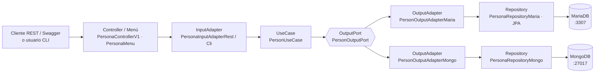

# personapp-hexa-spring-boot

[](https://github.com/samueldazag2/personapp-hexa-spring-boot/actions/workflows/ci.yml)

Laboratorio 2 de Arquitectura de Software (Pontificia Universidad Javeriana): servicio web PersonAPP
en **arquitectura hexagonal** (puertos y adaptadores) con los patrones **Repository** y **Service**.
Fork de la plantilla del profesor.

- Stack: Java 11 (target), Spring Boot 2.7.18, Maven multi-módulo, MariaDB, MongoDB, REST, CLI y
  Swagger 3 (springdoc).
- Modelo: `profesion(id, nom, des)`, `persona(cc, nombre, apellido, genero ENUM('M','F'), edad NULL)`,
  `estudios(id_prof, cc_per, fecha, univer)` con PK compuesta y `telefono(num, oper, duenio → persona.cc)`.

## Arquitectura

| Módulo | Capa | Responsabilidad |
|---|---|---|
| `common` | Transversal | Anotaciones propias (`@UseCase`, `@Adapter`, `@Mapper`, `@Port`), excepciones y `DatabaseOption`. |
| `domain` | Núcleo | Modelo de negocio puro (`Person`, `Profession`, `Study`, `Phone`, `Gender`). Sin Spring. |
| `application` | Núcleo | Puertos de entrada/salida y casos de uso (Service). |
| `maria-output-adapter` | Adaptador de salida | Persistencia en MariaDB con Spring Data JPA (Repository). |
| `mongo-output-adapter` | Adaptador de salida | Persistencia en MongoDB con Spring Data MongoDB (Repository). |
| `rest-input-adapter` | Adaptador de entrada | API REST + Swagger (`PersonAppRestApi`, puerto 3000). |
| `cli-input-adapter` | Adaptador de entrada | Menú de consola (`PersonAppCli`). |

Las dependencias apuntan hacia el núcleo: los adaptadores conocen a `application` y `domain`, nunca al
revés. Cada petición elige la base de datos (`MARIA` o `MONGO`) y el adaptador de entrada inyecta el
adaptador de salida correspondiente en el caso de uso.



## Requisitos

- JDK 11 o superior (el código se compila con `--release 11`; JDK 17 y 21 funcionan).
- Maven 3.8 o superior.
- Docker Desktop (con Docker Compose).
- Plugin de Lombok configurado en el IDE.

## Inicio rápido

```bash
# 1. Bases de datos (MariaDB :3307 y MongoDB :27017 con datos de ejemplo)
docker compose up -d
docker compose ps            # esperar a que ambas digan "healthy"

# 2. Compilar todo y correr las pruebas unitarias
mvn clean install

# 3. API REST (puerto 3000)
mvn -pl rest-input-adapter spring-boot:run
#    Swagger: http://localhost:3000/swagger-ui.html
#    Ejemplo: GET http://localhost:3000/api/v1/persona/maria  (o /mongo)

# 4. CLI (en otra terminal)
mvn -pl cli-input-adapter spring-boot:run
```

Para reiniciar las bases de datos desde cero: `docker compose down -v && docker compose up -d`.
Credenciales: usuario, clave y base `persona_db` en ambos motores (ver `application.properties`).

Los adaptadores de Profesión, Estudio y Teléfono ya están disponibles. Las aplicaciones pueden
arrancar con inicialización normal; no requieren activar inicialización perezosa para omitir beans.

## Estado actual

| Persona | Hecho | Pendiente |
|---|---|---|
| 1 — Núcleo y Maven | Puertos y casos de uso de las 4 entidades, pruebas, correcciones del núcleo, CI, `docker-compose` de BD, corrección de la plantilla. | — |
| 2 — Persistencia y Docker | Adaptadores de las cuatro entidades en MariaDB y MongoDB; mappers, integridad, pruebas reales, Dockerfiles y servicios REST/CLI. | Ver resultados y límites en `docs/persona2/RESULTADOS.md`. |
| 3 — REST, CLI y Swagger | REST: listar y crear persona (MARIA/MONGO) con validación de datos. CLI: listar personas. | CRUD completo (editar, borrar, buscar, contar) de las 4 entidades en REST y CLI, códigos HTTP adecuados y documentación Swagger. |

Probado (2026-11-09): `GET /api/v1/persona/{maria|mongo}` y `POST /api/v1/persona` contra ambas bases,
y "ver todas las personas" en la CLI con ambos motores.

## Documentación

- [CONTRIBUTING.md](CONTRIBUTING.md): flujo de ramas, commits, contratos y checklist de PR.
- [docs/persona1/README.md](docs/persona1/README.md): núcleo, contratos de los puertos e instrucciones
  para los adaptadores.
- [docs/persona1/revision.md](docs/persona1/revision.md): revisión del núcleo.
- [docs/fix-plantilla.md](docs/fix-plantilla.md): errores de la plantilla y cómo se corrigieron.


## Persona 2: persistencia y solución containerizada

Los adaptadores de Profession, Study y Phone están implementados para MariaDB y MongoDB. La documentación de diseño, relaciones, configuración y pruebas está en [docs/persona2/README.md](docs/persona2/README.md); el detalle de cambios y resultados en [RESULTADOS.md](docs/persona2/RESULTADOS.md), y la [guía de sustentación](docs/persona2/GUIA_ESTUDIO.md) referencia archivos y métodos.

```bash
# Solución completa: bases y API REST (conserva volúmenes existentes)
docker compose up -d --build rest
docker compose ps
# CLI interactiva
docker compose build cli
docker compose run --rm cli
# Solo bases, para desarrollo local y pruebas reales
docker compose up -d mariadb mongodb
mvn clean install -Dpersistence.integration=true
```

Las instrucciones previas de arranque local siguen disponibles; `docker compose up -d` ahora incluye REST. Dentro de Docker las conexiones usan los servicios `mariadb` y `mongodb`. Los scripts de inicialización se ejecutan únicamente al crear volúmenes vacíos.
