# Laboratorio 2 – Servicio web PersonAPP con arquitectura hexagonal (Spring Boot)

**Universidad:** Pontificia Universidad Javeriana\
**Facultad:** Ingeniería de Sistemas\
**Materia:** Arquitectura de Software\
**Profesor:** Andrés Sánchez\
**Integrantes:** José Eduardo Valeriano Castiblanco *(completar los demás integrantes)*\
**Fecha:** 15 de noviembre de 2026\
**Ciudad:** Bogotá D.C.

**Repositorio:** https://github.com/joseval29/personapp-hexa-spring-boot\
**Entrega (tag v1.0.0):** https://github.com/joseval29/personapp-hexa-spring-boot/tree/v1.0.0 *(pendiente de crear el tag)*

---

## 1. Marco conceptual

**Arquitectura hexagonal (puertos y adaptadores).** Alistair Cockburn propuso en 2005 separar la aplicación en un núcleo (las reglas de negocio) y en adaptadores que conectan el núcleo con el mundo exterior. Los *puertos* son las interfaces que el núcleo expone (de entrada) o necesita (de salida). Los *adaptadores* implementan esos puertos: un adaptador REST o de consola llama al núcleo, y un adaptador de MariaDB o de MongoDB es llamado por el núcleo. La ventaja es que el núcleo no depende de Spring, de HTTP ni de una base de datos concreta, y por eso se puede probar sin levantar nada de eso.

**Clean Architecture.** Robert C. Martin describe una estructura similar en capas concéntricas, con la regla de dependencia: las dependencias apuntan hacia adentro, hacia las entidades y los casos de uso. En PersonAPP, el módulo `domain` contiene las entidades, `application` los casos de uso y los puertos, y los módulos `*-adapter` contienen los detalles.

**Patrón Repository y servicio.** El repositorio abstrae el acceso a datos (en este proyecto, `JpaRepository` y `MongoRepository` quedan dentro de los adaptadores de salida). El servicio de la guía corresponde aquí a los casos de uso (`PersonUseCase`, `ProfessionUseCase`, `PhoneUseCase`, `StudyUseCase`), que implementan las reglas: no crear duplicados, no editar ni eliminar lo que no existe y no guardar referencias a personas inexistentes.

**Spring Boot e inyección de dependencias.** Spring Boot configura automáticamente la aplicación a partir de dependencias y propiedades. Las anotaciones `@Adapter`, `@UseCase`, `@Port` y `@Mapper` del módulo `common` son alias de `@Component`, de modo que Spring las registra como beans. Desde Spring Boot 4 algunas propiedades de conexión cambiaron de prefijo (por ejemplo, la conexión de MongoDB ahora se configura con `spring.mongodb.uri`).

**Persistencia.** MariaDB se accede con JPA/Hibernate mediante entidades con anotaciones (`@Entity`, `@EmbeddedId`, `@ManyToOne`). MongoDB se accede con Spring Data, usando documentos (`@Document`) y referencias (`@DocumentReference`), que se guardan como el identificador del otro documento y no como un `DBRef`.

**REST y códigos de estado.** REST modela la API como recursos (`/api/v1/persona/{database}/{id}`) manipulados con verbos HTTP. Los códigos indican el resultado: 200 (operación exitosa con cuerpo), 204 (eliminación exitosa sin cuerpo), 400 (datos inválidos), 404 (no existe), 409 (ya existe o referencia inexistente).

**OpenAPI 3 y Swagger.** springdoc-openapi 3.2.0 genera la especificación OpenAPI 3 y la interfaz Swagger UI, en `/swagger-ui.html`.

**Interfaz de consola (CLI).** Un adaptador de entrada alternativo ofrece los mismos casos de uso desde un menú interactivo, sin cambiar el núcleo. Es la demostración práctica de que la arquitectura permite agregar entradas nuevas.

**Docker y Docker Compose.** Docker empaqueta los servicios en contenedores y Compose los orquesta. En este proyecto Compose levanta MariaDB, MongoDB, un servicio de inicialización de MongoDB, la API y la CLI como perfil opcional.

**Principios SOLID.** La separación en puertos segregados (ISP), el registro de motores (DIP y OCP) y el contrato de los puertos (LSP) se aplicaron de forma explícita. Están documentados en el README del proyecto.

**Pruebas.** Se distinguen pruebas unitarias (casos de uso, mappers, controladores y menús con dependencias simuladas) y pruebas de integración (la API real contra las bases de datos en Docker).

---

## 2. Diseño

### 2.1 Modelo de datos

El modelo entregado en el enunciado tiene cuatro entidades. En MariaDB se implementó con el DDL de `scripts/persona_ddl_maria.sql`:

| Tabla | Clave primaria | Campos | Relaciones |
|---|---|---|---|
| `persona` | `cc` (INT 15) | nombre (VARCHAR 45), apellido (VARCHAR 45), genero (ENUM 'M','F'), edad (INT 3) | 1:N con `telefono` y con `estudios` |
| `profesion` | `id` (INT 6) | nom (VARCHAR 90), des (TEXT) | 1:N con `estudios` |
| `estudios` | (`id_prof`, `cc_per`) | fecha (DATE), univer (VARCHAR 50) | N:M entre `persona` y `profesion` |
| `telefono` | `num` (VARCHAR 15) | oper (VARCHAR 45), duenio (INT 15) | N:1 con `persona` (clave foránea `duenio`) |

En MongoDB, cada entidad es una colección (`persona`, `profesion`, `telefono`, `estudios`). Las referencias se guardan como el identificador del documento relacionado. Un estudio tiene como `_id` la combinación `cédula-idProfesion`, que replica la clave compuesta de MariaDB.

**Decisiones sobre el modelo.** El esquema usa `utf8mb4` para conservar tildes y eñes (sin esto los acentos se guardaban corruptos). La fecha de grado es `LocalDate` en la entidad JPA, porque la clase `java.util.Date` estaba deprecada y devolvía tipos sin soporte para `toInstant()`.

### 2.2 Arquitectura hexagonal

El diagrama muestra las capas y la regla de dependencia: los adaptadores de entrada (API REST y CLI) y de salida (MariaDB y MongoDB) dependen del núcleo, y el núcleo no depende de ninguno de ellos.

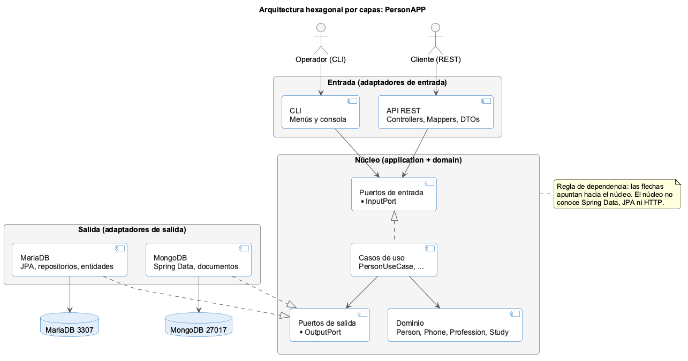

Fuente: [`diagramas/08_arquitectura_capas.puml`](diagramas/08_arquitectura_capas.puml).

### 2.3 Módulos y clases principales

| Módulo | Responsabilidad | Clases principales |
|---|---|---|
| `common` | Anotaciones, excepciones, motores y validación compartida | `DatabaseOption`, `PersistenceRegistry`, `Entrada`, `AlreadyExistException`, `NoExistException`, `InvalidOptionException` |
| `domain` | Modelo del dominio | `Person`, `Phone`, `Profession`, `Study`, `Gender` |
| `application` | Puertos y casos de uso | `PersonInputPort`, `PersonOutputPort`, `PersonUseCase`, `ProfessionUseCase`, `PhoneUseCase`, `StudyUseCase` |
| `maria-output-adapter` | Adaptadores de salida con JPA | `PersonOutputAdapterMaria`, `ProfessionOutputAdapterMaria`, `PhoneOutputAdapterMaria`, `StudyOutputAdapterMaria`; entidades y repositorios `JpaRepository` |
| `mongo-output-adapter` | Adaptadores de salida con Spring Data | `PersonOutputAdapterMongo` (con cascada), `ProfessionOutputAdapterMongo`, `PhoneOutputAdapterMongo`, `StudyOutputAdapterMongo`; documentos y repositorios `MongoRepository` |
| `rest-input-adapter` | API REST | `PersonaControllerV1`, `ProfesionControllerV1`, `TelefonoControllerV1`, `EstudioControllerV1`, `ApiExceptionHandler`, `PersistenceConfig` |
| `cli-input-adapter` | Menú de consola | `PersonaMenu`, `ProfesionMenu`, `TelefonoMenu`, `EstudioMenu`, `MenuBase` |

### 2.4 Estructura de carpetas

```
personapp-hexa-spring-boot/        (raíz del repositorio, git)
├── pom.xml                        padre Maven (Spring Boot 4.1.2, Java 25)
├── Dockerfile                     build multietapa; MODULE=rest-input-adapter | cli-input-adapter
├── docker-compose.yml             MariaDB, MongoDB, mongo-init, api y cli
├── personapp.http                 peticiones de prueba (REST Client)
├── docker/mongo-init.sh           carga el DDL y DML de MongoDB
├── scripts/                       DDL y DML de MariaDB y MongoDB
├── tests/run-integration-tests.sh levanta Docker Compose y corre las pruebas de integración
├── docs/                          este documento y diagramas C4
├── common/                        anotaciones, excepciones, Entrada, PersistenceRegistry
├── domain/                        Person, Phone, Profession, Study
├── application/                   puertos y casos de uso
├── maria-output-adapter/          JPA: entidades, repositorios y mappers
├── mongo-output-adapter/          Spring Data: documentos, repositorios y mappers
├── rest-input-adapter/            API REST: controladores, adaptadores, mappers, DTOs y configuración
└── cli-input-adapter/             menú de consola
```

### 2.5 Endpoints REST

Todas las rutas empiezan por `/api/v1`. `{database}` puede ser `maria` o `mongo`; cualquier otro valor responde 400.

| Recurso | GET lista | GET por id | POST | PUT | DELETE |
|---|---|---|---|---|---|
| `/persona` | `/{database}` (200) | `/{database}/{cc}` (200 / 404) | `/` (200 / 400 / 409) | `/{database}/{cc}` (200 / 400 / 404) | `/{database}/{cc}` (204 / 404) |
| `/profesion` | `/{database}` (200) | `/{database}/{id}` (200 / 404) | `/` (200 / 400 / 409) | `/{database}/{id}` (200 / 400 / 404) | `/{database}/{id}` (204 / 404) |
| `/telefono` | `/{database}` (200) | `/{database}/{numero}` (200 / 404) | `/` (200 / 400 / 409) | `/{database}/{numero}` (200 / 400 / 404) | `/{database}/{numero}` (204 / 404) |
| `/estudio` | `/{database}` (200) | `/{database}/{cc}/{idProf}` (200 / 404) | `/` (200 / 400 / 409) | `/{database}/{cc}/{idProf}` (200 / 400 / 404) | `/{database}/{cc}/{idProf}` (204 / 404) |

Las peticiones de ejemplo de cada endpoint están en `personapp.http`.

### 2.6 Decisiones de diseño

- **Registro de motores en lugar de `if` por base de datos.** Cada adaptador de entrada recibe un `PersistenceRegistry` con el puerto de cada motor. Agregar un motor no obliga a cambiar los adaptadores de entrada (principio abierto/cerrado y de inversión de dependencias).
- **Puertos segregados.** Cada agregado tiene sus propios puertos de entrada y salida. Se eliminó de `PersonInputPort` un método de salida que no le correspondía (principio de segregación de interfaces).
- **Contrato de los puertos.** Los adaptadores de salida no reportan éxito cuando una escritura falla. Antes, el adaptador de MongoDB devolvía la persona aunque no se hubiera guardado.
- **Validación de entrada compartida.** `Entrada` valida los datos en la API y en la CLI con los mismos límites del esquema: DNI y ids positivos, texto con longitud máxima (45, 90, 15, 50), edad entre 0 y 150, género `M` o `F`, y fechas `yyyy-MM-dd`. Las entradas inválidas responden 400 en lugar de 409 o 500.
- **Mapeo superficial de objetos anidados.** Una persona dentro de un teléfono o de un estudio se convierte solo con sus datos básicos. Mapear de forma recursiva persona ↔ estudios generaba recursión infinita en cuanto había datos.
- **Cascada en ambas bases.** En MariaDB la cascada la hace JPA (`CascadeType.ALL`). En MongoDB la hacen explícitamente los adaptadores: al eliminar una persona se borran sus teléfonos y estudios, y al eliminar una profesión se borran sus estudios.
- **Validación de referencias en MongoDB.** Como MongoDB no tiene claves foráneas, antes de guardar un teléfono o un estudio el adaptador comprueba que la persona (y la profesión) existan. Si no existen, responde 409.
- **Código de respuesta de creación.** Los `POST` responden 200 con el cuerpo creado (no 201) para mantener un formato uniforme con los demás verbos; esta es una decisión que se puede cambiar.
- **Configuración por entorno.** Las conexiones se configuran con variables de entorno (`SPRING_DATASOURCE_URL`, `SPRING_MONGODB_URI`), así que el mismo código corre en Docker y en local.
- **Inicialización de MongoDB con un servicio aparte.** El servicio `mongo-init` carga el DDL y el DML después de que el servidor responde, con credenciales explícitas. La imagen oficial de MongoDB no ejecutaba los scripts con las credenciales correctas.

### 2.7 Diagramas C4

Los diagramas siguen el modelo C4 de Simon Brown, con los mismos niveles de zoom del laboratorio uno: del paisaje del sistema hasta el código. Se incluyen dos dinámicos (un POST y un borrado en cascada) y el despliegue en Docker.

**Paisaje del sistema.** Quién usa PersonAPP y qué sistemas externos intervienen (GitHub, Maven Central y Docker Hub).

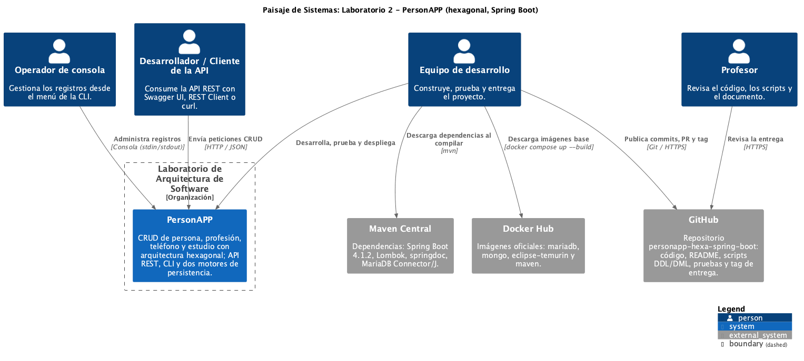

**Nivel 1, contexto.** El operador de la consola, el cliente de la API y el sistema como una sola caja.

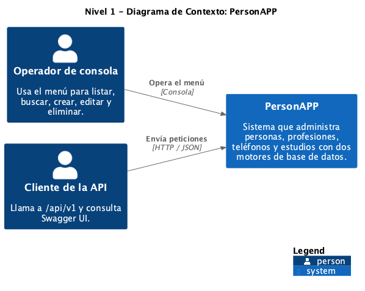

**Nivel 2, contenedores.** La API, la CLI, MariaDB, MongoDB y el servicio `mongo-init`, dentro de Docker Compose.

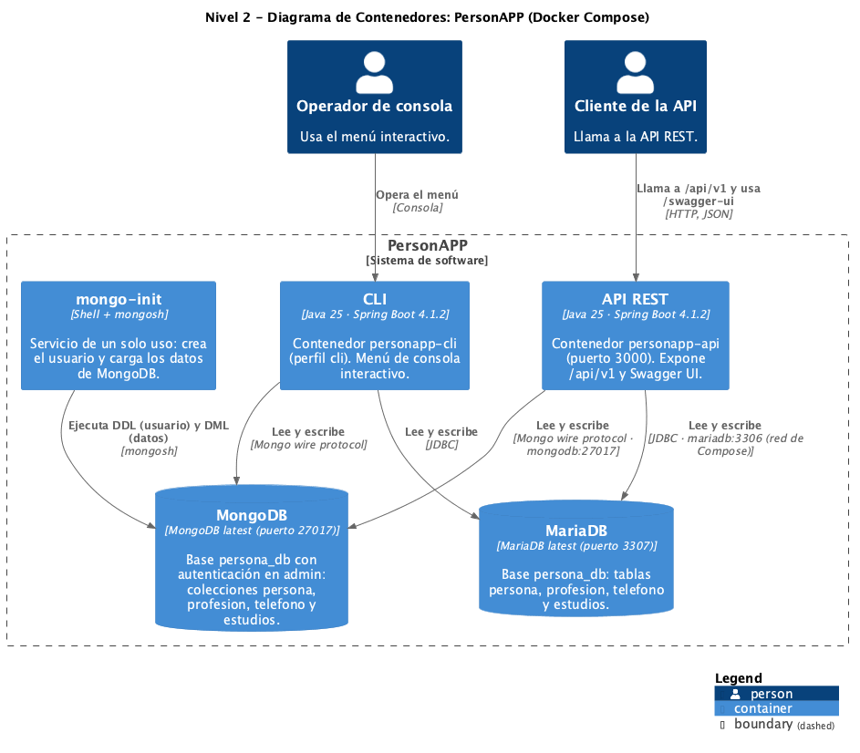

**Nivel 3, componentes.** Los controladores, los adaptadores de entrada, los casos de uso, los puertos y los adaptadores de salida, con la configuración de motores.

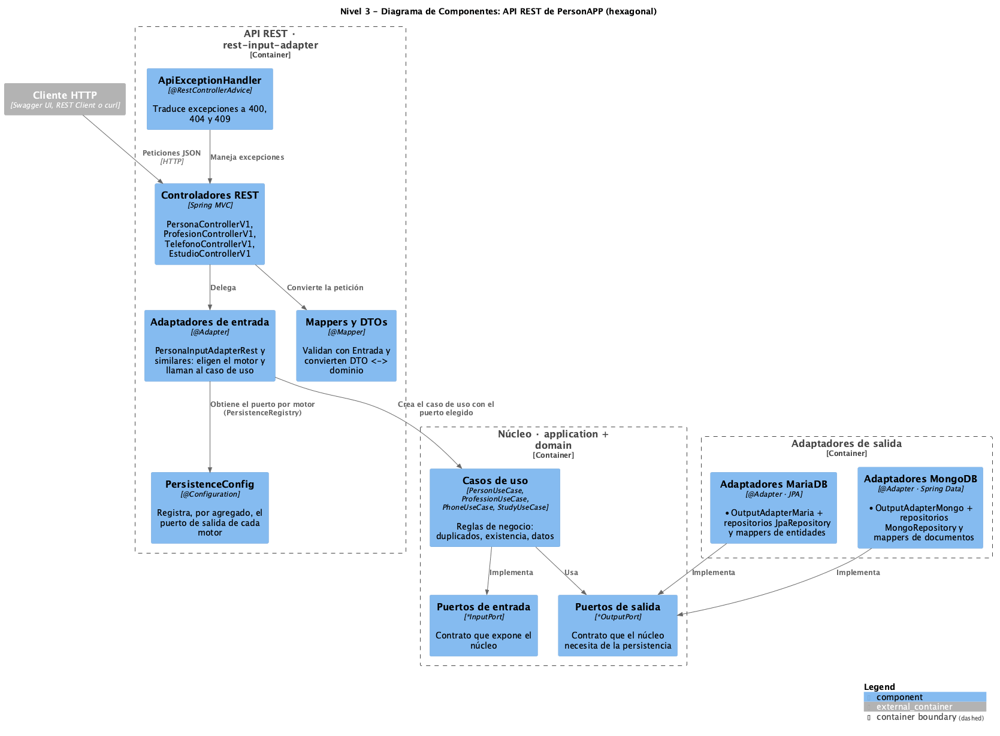

**Nivel 4, código.** Las clases principales del flujo de `Persona`, con sus métodos y las excepciones que cada uno lanza.

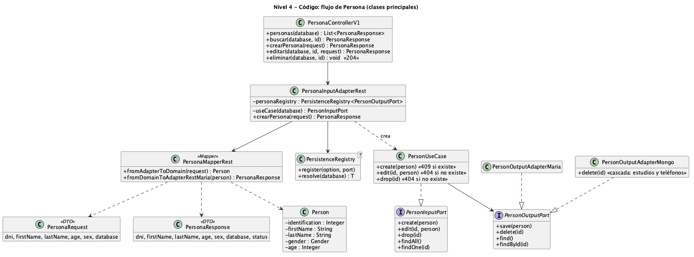

**Dinámico: crear persona por la API.** Recorrido de un `POST /api/v1/persona` hasta la inserción en MariaDB, con la verificación de duplicados.

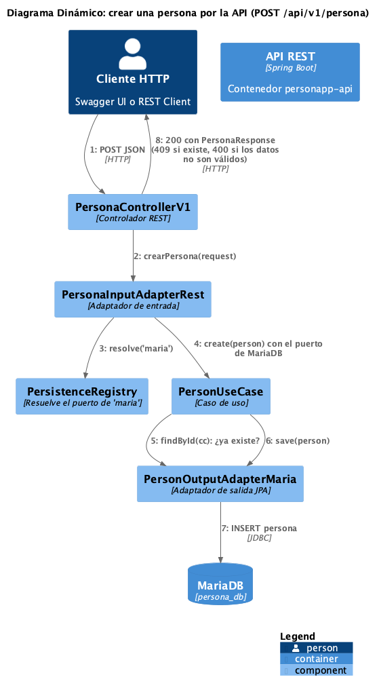

**Dinámico: eliminar persona en MongoDB (borrado en cascada).** Recorrido de un `DELETE` que borra primero los estudios, después los teléfonos y al final la persona.

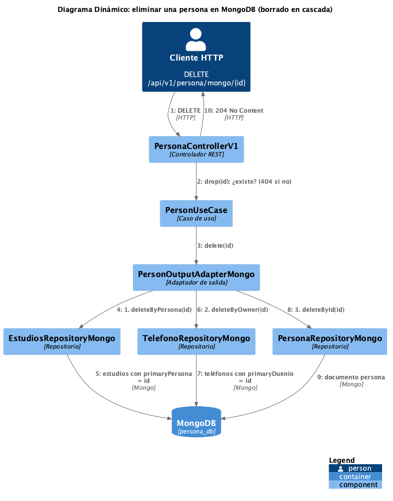

**Despliegue.** Docker Desktop en macOS con la red de Compose, los cuatro servicios, el servicio de inicialización y los volúmenes de datos.

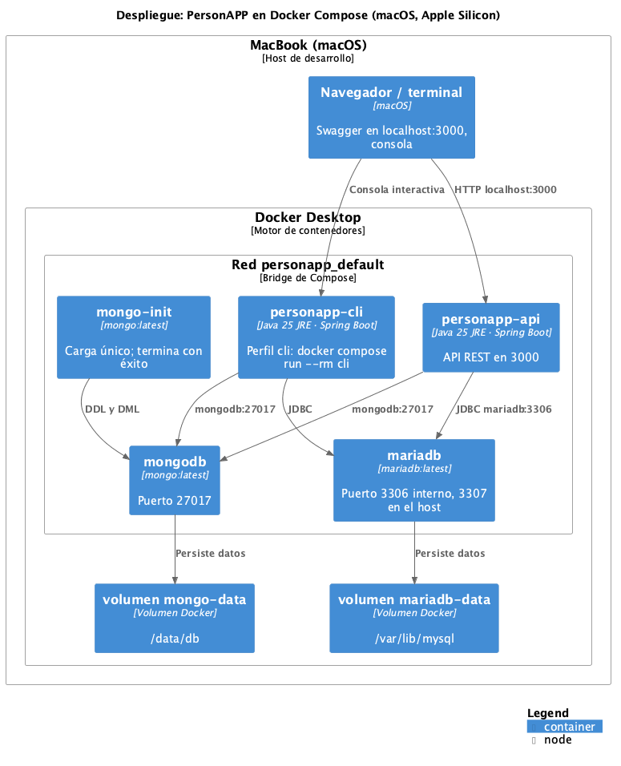

Todas las fuentes están en `docs/diagramas/` y el índice en `docs/diagramas/LEEME.md`.


### 2.8 Recorrido por el proyecto

Este recorrido muestra, carpeta por carpeta, la estructura del proyecto con capturas de Visual Studio Code. El proyecto sigue la arquitectura hexagonal: el dominio y la lógica de negocio están en el centro y no dependen de la tecnología. La comunicación con el exterior se hace por puertos (interfaces) que implementan los adaptadores de entrada (API REST y consola) y de salida (MariaDB y MongoDB).

**Flujo de una petición:** controlador REST → adaptador de entrada → caso de uso (puerto de entrada) → puerto de salida → adaptador de salida (MariaDB o MongoDB) → repositorio → base de datos.

#### 2.8.1 Vista general del proyecto

La raíz contiene un proyecto Maven multimódulo. Cada módulo corresponde a una capa de la arquitectura hexagonal.
**Captura 1.** Raíz del proyecto abierta en Visual Studio Code.

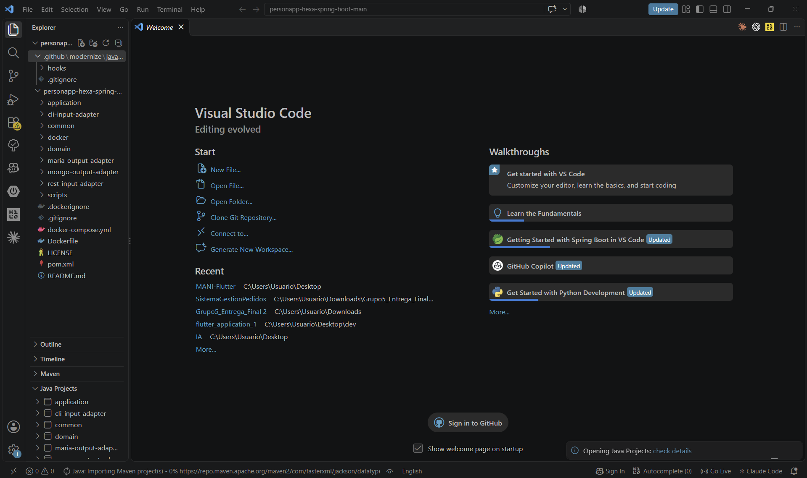

| Archivo / carpeta | Para qué sirve |
|---|---|
| `application` | Capa de aplicación: puertos de entrada y salida, casos de uso y sus pruebas. |
| `cli-input-adapter` | Adaptador de entrada por consola: menús de texto para usar la aplicación desde la terminal. |
| `common` | Código compartido: anotaciones propias, excepciones, configuración de persistencia y validación de entrada (`validation/Entrada.java`). |
| `docker` | Script auxiliar `mongo-init.sh` que carga el esquema y los datos de MongoDB al levantar los contenedores. |
| `domain` | Núcleo del sistema: las entidades del negocio (Persona, Profesión, Teléfono, Estudio). |
| `maria-output-adapter` | Adaptador de salida que guarda y consulta los datos en MariaDB (SQL). |
| `mongo-output-adapter` | Adaptador de salida que guarda y consulta los datos en MongoDB (NoSQL). |
| `rest-input-adapter` | Adaptador de entrada que expone la API REST (controladores HTTP). |
| `scripts` | Scripts DDL y DML de MariaDB y MongoDB con datos de ejemplo. |
| `tests` | Script `run-integration-tests.sh`: levanta Docker Compose, espera a la API y ejecuta las pruebas de integración. |
| `docs` | Documento del laboratorio, diagramas C4 y este recorrido. |
| `pom.xml` | Archivo Maven padre que declara los módulos, las versiones y las dependencias comunes. |
| `Dockerfile` / `docker-compose.yml` | Construcción de la imagen de la aplicación y orquestación de los contenedores. |
| `personapp.http` | Peticiones de prueba de la API (REST Client). |
| `.dockerignore`, `.gitignore`, `LICENSE`, `README.md` | Archivos que Docker y Git ignoran, licencia Apache 2.0 y documentación general. |

#### 2.8.2 `pom.xml` de la raíz

Es el POM padre del proyecto. Hereda de `spring-boot-starter-parent` (Spring Boot 4.1.2), usa empaquetado `pom` porque solo agrupa módulos, y define propiedades comunes: Java 25, Lombok 1.18.48, springdoc 3.2.0 y el conector de MariaDB.
**Captura 2.** Inicio del `pom.xml`: proyecto padre y propiedades.

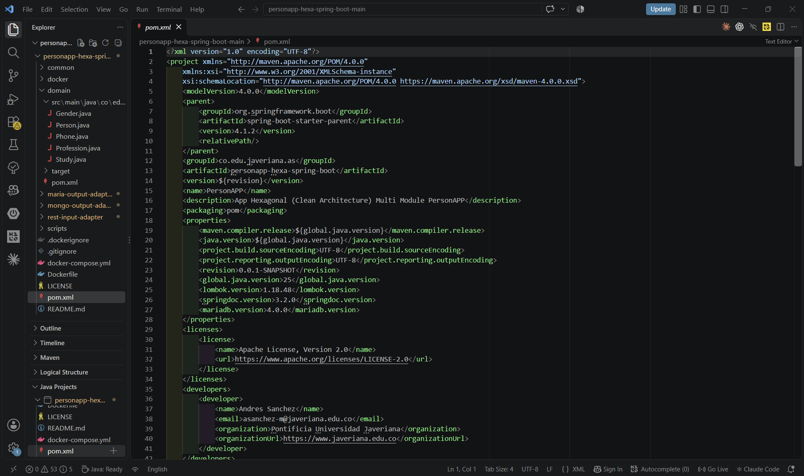
**Captura 3.** Sección `<modules>` del `pom.xml`.

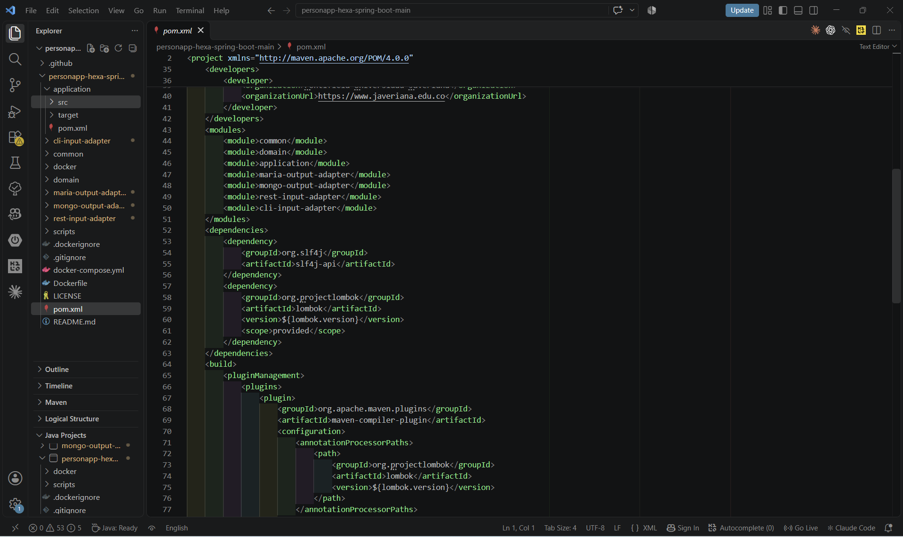

| Sección | Para qué sirve |
|---|---|
| `<parent>` | Hereda la configuración base de Spring Boot. |
| `<properties>` | Versiones centralizadas (Java, Lombok, springdoc, MariaDB) para que todos los módulos usen las mismas. |
| `<modules>` | Lista los 7 módulos en orden de construcción: common, domain, application, maria-output-adapter, mongo-output-adapter, rest-input-adapter y cli-input-adapter. |
| `<dependencies>` | Dependencias que heredan todos los módulos: slf4j (logs) y Lombok (genera getters, setters y constructores). |
| `<build>` | Configura el compilador de Maven para que procese las anotaciones de Lombok. |

#### 2.8.3 Módulo `domain`

Es el centro de la arquitectura. Contiene las clases del modelo de negocio y no depende de ninguna base de datos ni de ningún framework web, solo de Lombok.
**Captura 4.** Carpeta `domain` con `Profession.java` abierto.

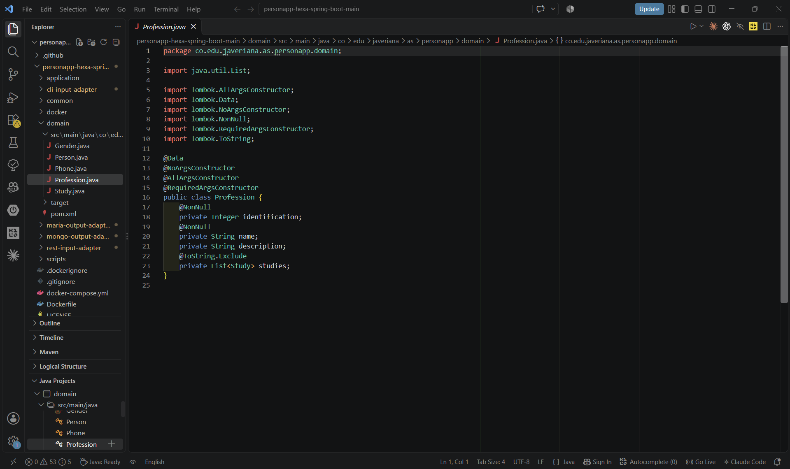

| Archivo | Para qué sirve |
|---|---|
| `Person.java` | Persona: identificación, nombre, apellido, género, edad, y sus teléfonos y estudios. |
| `Profession.java` | Profesión: identificación, nombre, descripción y los estudios asociados. |
| `Phone.java` | Teléfono: número, operador y la persona dueña. |
| `Study.java` | Relación entre una persona y una profesión: fecha de graduación y universidad. |
| `Gender.java` | Enumeración del género: `MALE`, `FEMALE` y `OTHER`. |

#### 2.8.4 Módulo `application`: puertos de entrada (`port/in`)

Los puertos de entrada son interfaces que definen qué operaciones ofrece la aplicación al exterior. Los adaptadores de entrada solo conocen estas interfaces. Están marcados con la anotación propia `@Port`.
**Captura 5.** Carpeta `port/in` con `PersonInputPort.java` abierto.

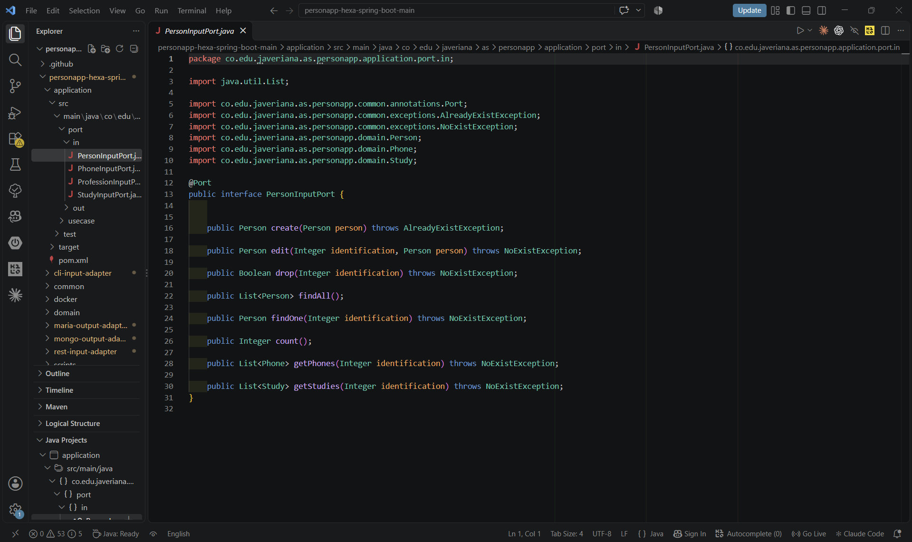

| Archivo | Para qué sirve |
|---|---|
| `PersonInputPort.java` | Operaciones sobre personas: `create`, `edit`, `drop`, `findAll`, `findOne`, `count`, `getPhones` y `getStudies`. |
| `ProfessionInputPort.java` | Operaciones CRUD sobre profesiones. |
| `PhoneInputPort.java` | Operaciones CRUD sobre teléfonos. |
| `StudyInputPort.java` | Operaciones CRUD sobre estudios. |

#### 2.8.5 Módulo `application`: puertos de salida (`port/out`)

Los puertos de salida indican qué necesita la aplicación de la persistencia, sin decir cómo se hace. Los adaptadores de MariaDB y MongoDB los implementan, por eso la base de datos se puede cambiar sin tocar la lógica de negocio.
**Captura 6.** Carpeta `port/out` con `PersonOutputPort.java` abierto.

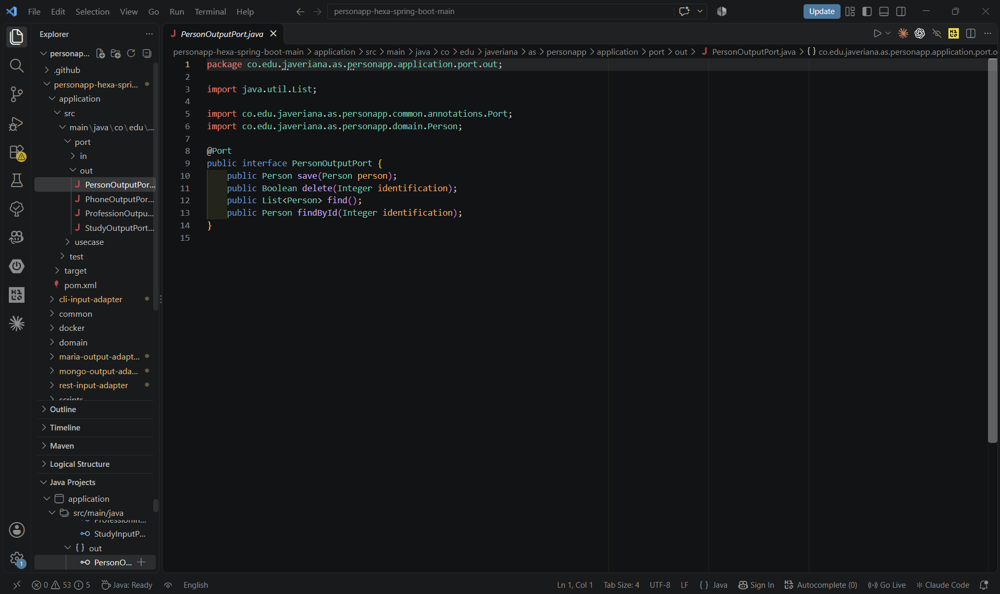

| Archivo | Para qué sirve |
|---|---|
| `PersonOutputPort.java` | Define `save`, `delete`, `find` y `findById` para personas. |
| `ProfessionOutputPort.java` | Operaciones de persistencia para profesiones. |
| `PhoneOutputPort.java` | Operaciones de persistencia para teléfonos. |
| `StudyOutputPort.java` | Operaciones de persistencia para estudios. |

#### 2.8.6 Módulo `application`: casos de uso (`usecase`)

Equivale a la capa de servicios de otras arquitecturas. Aquí está la lógica de negocio: cada caso de uso implementa su puerto de entrada y recibe por constructor un puerto de salida. Por ejemplo, `PersonUseCase` valida que la persona no exista antes de crearla y lanza `AlreadyExistException` si ya existe.
**Captura 7.** Carpeta `usecase` con `PersonUseCase.java` abierto.

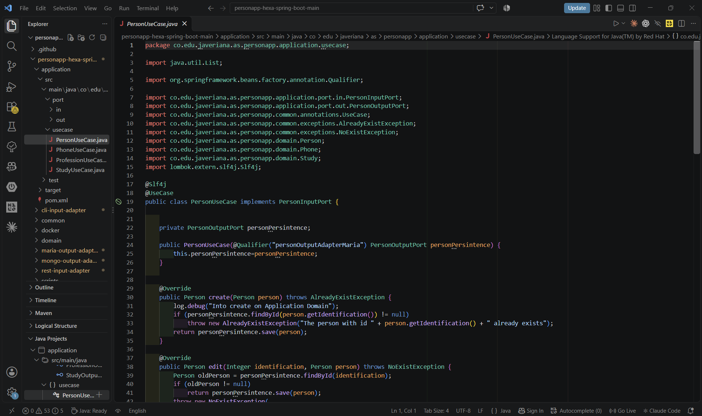

| Archivo | Para qué sirve |
|---|---|
| `PersonUseCase.java` | Implementa `PersonInputPort`: crear, editar, eliminar, listar, buscar y contar personas, y consultar sus teléfonos y estudios. |
| `ProfessionUseCase.java` | Implementa `ProfessionInputPort` con las reglas para profesiones. |
| `PhoneUseCase.java` | Implementa `PhoneInputPort` con las reglas para teléfonos. |
| `StudyUseCase.java` | Implementa `StudyInputPort` con las reglas para estudios. |

#### 2.8.7 Módulo `application`: pruebas

Contiene las pruebas unitarias de los casos de uso. Como dependen de interfaces (puertos), se prueban sin una base de datos real, con objetos simulados (Mockito).
**Captura 8.** Carpeta `src/test` con las pruebas de los casos de uso.

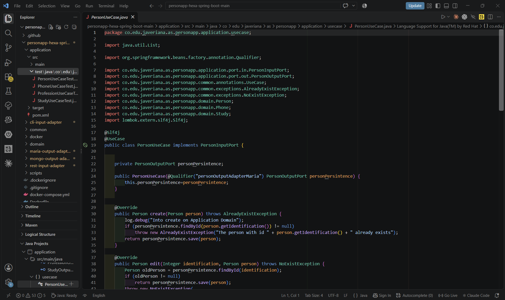

| Archivo | Para qué sirve |
|---|---|
| `PersonUseCaseTest.java` | Pruebas de `PersonUseCase`. |
| `ProfessionUseCaseTest.java` | Pruebas de `ProfessionUseCase`. |
| `PhoneUseCaseTest.java` | Pruebas de `PhoneUseCase`. |
| `StudyUseCaseTest.java` | Pruebas de `StudyUseCase`. |

#### 2.8.8 Módulo `common`

Código transversal que usan todos los módulos. Las anotaciones propias son alias de `@Component` de Spring, así las demás capas no dependen directamente del framework.
**Captura 9.** Carpetas `annotations`, `exceptions` y `setup`, con `UseCase.java` abierto.

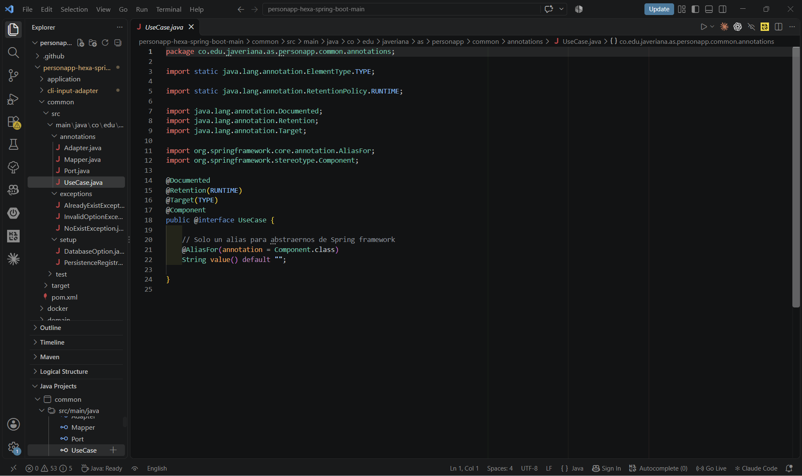

| Archivo / carpeta | Para qué sirve |
|---|---|
| `annotations/Adapter.java`, `Mapper.java`, `Port.java`, `UseCase.java` | Marcan los adaptadores, los mapeadores, los puertos y los casos de uso. |
| `exceptions/AlreadyExistException.java` | Se lanza al crear un registro que ya existe. |
| `exceptions/NoExistException.java` | Se lanza al buscar, editar o borrar un registro que no existe. |
| `exceptions/InvalidOptionException.java` | Se lanza cuando la base de datos elegida no es válida. |
| `setup/DatabaseOption.java` | Enumeración de los motores disponibles: `MARIA` y `MONGO`. |
| `setup/PersistenceRegistry.java` | Asocia cada motor con su puerto de salida para elegir la base de datos en tiempo de ejecución. |
| `validation/Entrada.java` | Validaciones de entrada compartidas por la API y la CLI: DNI positivo, longitudes máximas, edad entre 0 y 150, género `M` o `F`, y fechas `yyyy-MM-dd`. |

#### 2.8.9 `rest-input-adapter`: controladores (`controller`)

Es la puerta de entrada HTTP. Cada controlador expone endpoints REST y delega en su adaptador de entrada. `PersonaControllerV1` atiende `/api/v1/persona` con `GET /{database}`, `GET /{database}/{id}`, `POST`, `PUT /{database}/{id}` y `DELETE /{database}/{id}`; el parámetro `database` indica si se usa MariaDB o MongoDB.
**Captura 10.** Carpeta `controller` con `PersonaControllerV1.java` abierto.

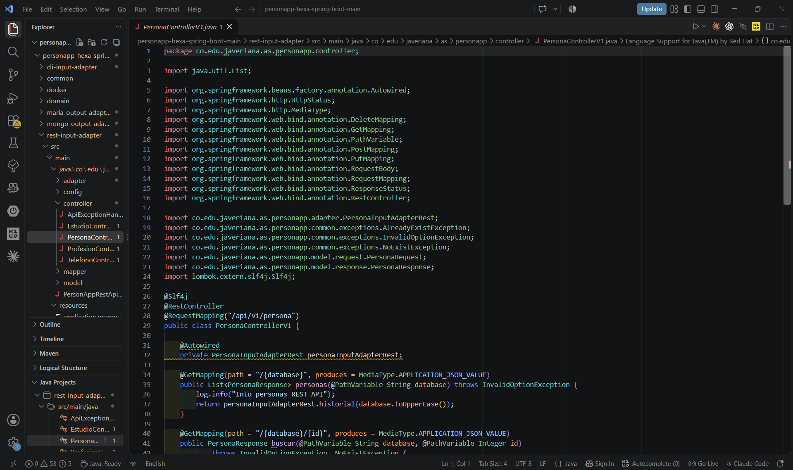

| Archivo | Para qué sirve |
|---|---|
| `PersonaControllerV1.java` | Endpoints REST de personas. |
| `ProfesionControllerV1.java` | Endpoints REST de profesiones. |
| `TelefonoControllerV1.java` | Endpoints REST de teléfonos. |
| `EstudioControllerV1.java` | Endpoints REST de estudios. |
| `ApiExceptionHandler.java` | Convierte las excepciones (`NoExistException`, `AlreadyExistException`, `InvalidOptionException` y entradas inválidas) en respuestas HTTP 404, 409 o 400. |

#### 2.8.10 `rest-input-adapter`: adaptadores y mapeadores

El adaptador conecta el mundo REST con el núcleo: recibe la petición, usa el `PersistenceRegistry` para obtener el puerto de salida de la base elegida, crea el caso de uso y transforma el resultado en una respuesta. Los mapeadores convierten entre objetos REST y objetos de dominio, y validan con `Entrada` antes de construir el dominio.
**Captura 11.** Carpetas `adapter` y `mapper`, con `PersonaInputAdapterRest.java` abierto.

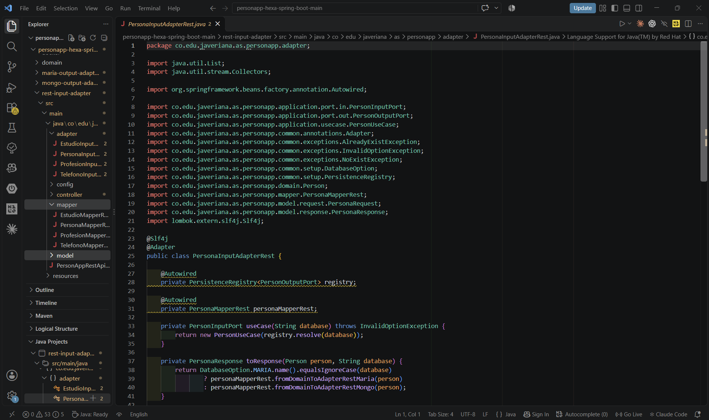

| Archivo | Para qué sirve |
|---|---|
| `adapter/PersonaInputAdapterRest.java` | Orquesta las operaciones de personas desde la API. |
| `adapter/ProfesionInputAdapterRest.java` | Lo mismo para profesiones. |
| `adapter/TelefonoInputAdapterRest.java` | Lo mismo para teléfonos. |
| `adapter/EstudioInputAdapterRest.java` | Lo mismo para estudios. |
| `mapper/*MapperRest.java` | Convierten `Request` a dominio y dominio a `Response`, una clase por entidad. |

#### 2.8.11 `rest-input-adapter`: modelos (`model`)

Son los objetos que viajan en JSON por la API. Se separan del dominio para que cambiar la forma de la API no afecte al núcleo.
**Captura 12.** Carpetas `request` y `response`, con `PersonaRequest.java` abierto.

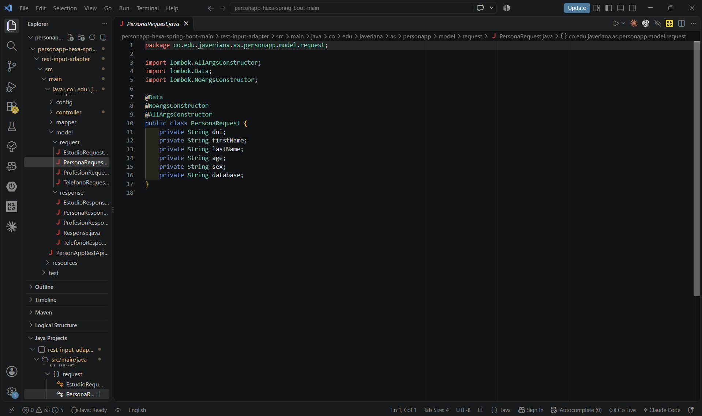

| Archivo | Para qué sirve |
|---|---|
| `request/PersonaRequest.java` | Datos para crear o editar una persona: `dni`, `firstName`, `lastName`, `age`, `sex` y `database`. |
| `request/ProfesionRequest`, `TelefonoRequest`, `EstudioRequest` | Datos de entrada para las otras entidades. |
| `response/PersonaResponse`, `ProfesionResponse`, `TelefonoResponse`, `EstudioResponse` | Datos que la API devuelve para cada entidad. |
| `response/Response.java` | Respuesta genérica con estado, descripción y fecha, usada para los errores. |

#### 2.8.12 `rest-input-adapter`: configuración y arranque
**Captura 13.** `PersistenceConfig.java`.

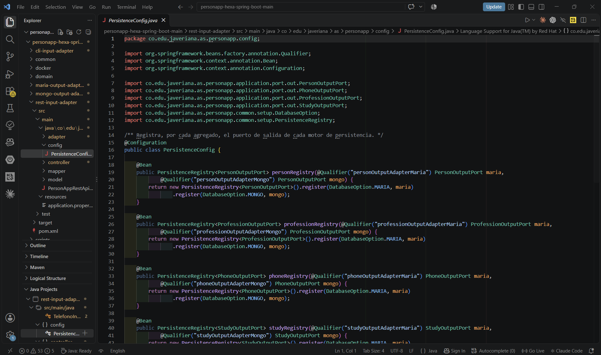
**Captura 14.** `application.properties`.

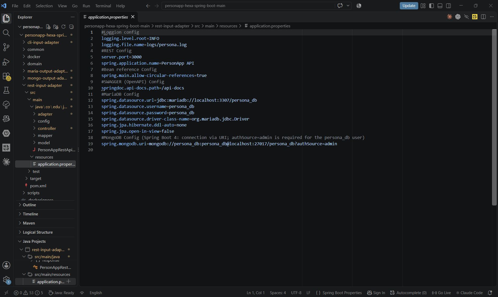
**Captura 15.** `PersonAppRestApi.java`.

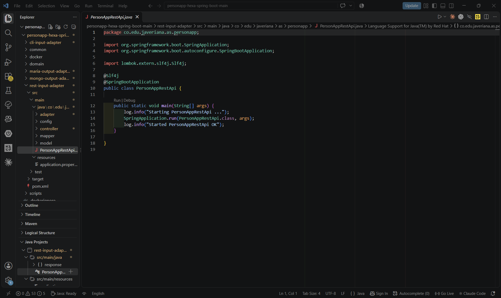

| Archivo | Para qué sirve |
|---|---|
| `config/PersistenceConfig.java` | Crea un `PersistenceRegistry` por cada entidad y registra en él el adaptador de MariaDB y el de MongoDB. |
| `resources/application.properties` | Logs, puerto 3000, documentación OpenAPI en `/api-docs` (Swagger UI en `/swagger-ui.html`), y conexiones a MariaDB (3307) y MongoDB (27017). |
| `PersonAppRestApi.java` | Clase principal con `@SpringBootApplication` y `main`, que inicia la API. |

#### 2.8.13 Módulo `cli-input-adapter`

Es un segundo adaptador de entrada que usa los mismos casos de uso que la API REST, pero desde un menú en la consola. Demuestra que el núcleo no depende de la forma de entrada.
**Captura 16.** Estructura del módulo, con `PersonAppCli.java` abierto.

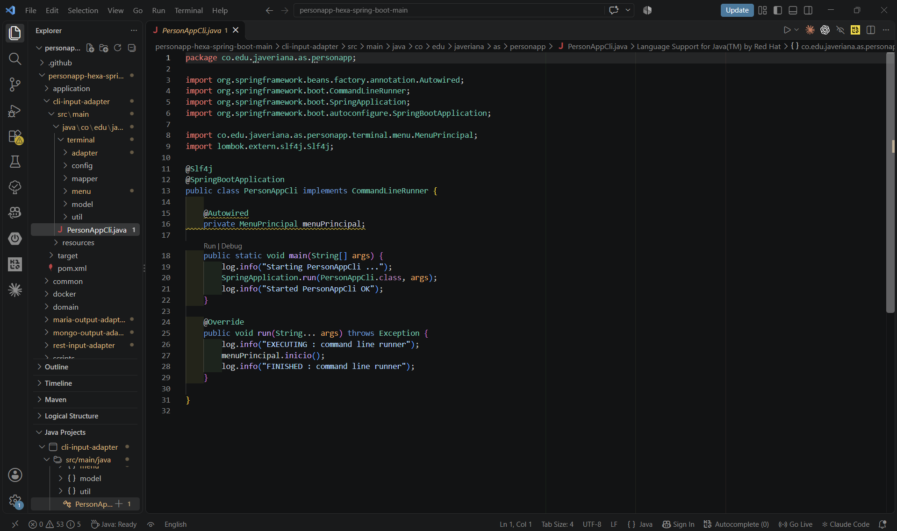
**Captura 17.** Carpetas `adapter` y `menu`, con `MenuPrincipal.java` abierto.

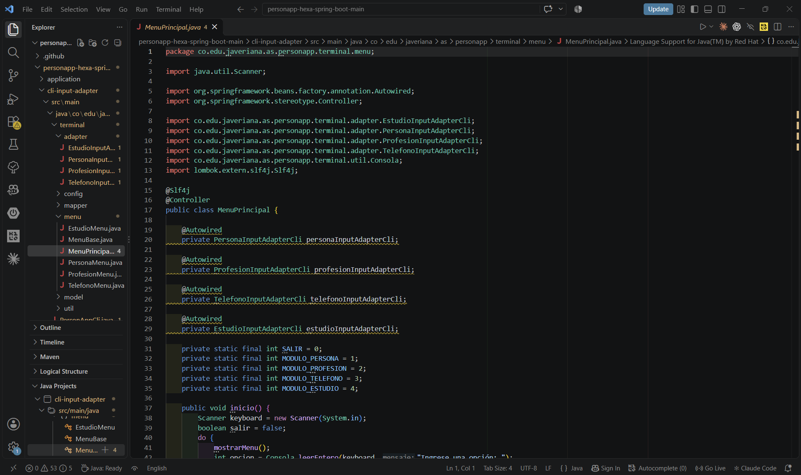

| Archivo / carpeta | Para qué sirve |
|---|---|
| `PersonAppCli.java` | Clase principal; implementa `CommandLineRunner` y al arrancar abre el menú principal. |
| `terminal/adapter/*InputAdapterCli.java` | Adaptadores de Persona, Profesión, Teléfono y Estudio que llaman a los casos de uso y muestran resultados. |
| `terminal/config/PersistenceConfig.java` | Registra los adaptadores de MariaDB y MongoDB, igual que en el módulo REST. |
| `terminal/mapper/PersonaMapperCli.java` | Convierte objetos de dominio al modelo de consola. |
| `terminal/menu/MenuPrincipal.java` | Menú inicial para elegir el módulo: persona, profesión, teléfono o estudio. |
| `terminal/menu/MenuBase.java` | Clase base con la lógica común de todos los menús (elegir motor y operaciones CRUD). |
| `terminal/menu/PersonaMenu`, `ProfesionMenu`, `TelefonoMenu`, `EstudioMenu` | Submenús con las opciones de cada entidad. |
| `terminal/model/PersonaModelCli.java` | Representación de una persona para mostrarla en consola. |
| `terminal/util/Consola.java` | Utilidades para leer datos del teclado (`leerEntero`, `leerTexto`, `leerOpcional`). |

#### 2.8.14 Módulo `maria-output-adapter`

Adaptador de salida para la base relacional MariaDB, con JPA (Jakarta Persistence) y Spring Data.
**Captura 18.** Carpetas `adapter`, `entity` y `mapper`, con `PersonaEntity.java` abierto.

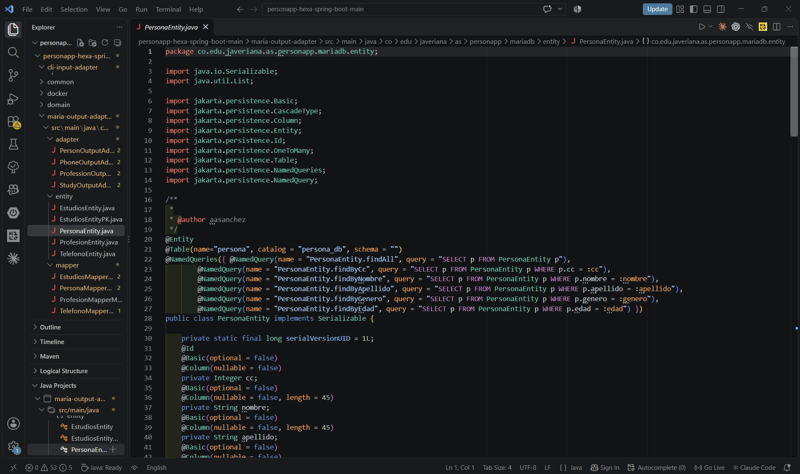

| Archivo / carpeta | Para qué sirve |
|---|---|
| `adapter/*OutputAdapterMaria.java` | Implementan los puertos de salida (por ejemplo, `PersonOutputAdapterMaria` implementa `PersonOutputPort`) y se registran con un nombre como `personOutputAdapterMaria`. |
| `entity/PersonaEntity`, `ProfesionEntity`, `TelefonoEntity`, `EstudiosEntity` | Clases JPA mapeadas a las tablas `persona`, `profesion`, `telefono` y `estudios`. |
| `entity/EstudiosEntityPK.java` | Llave primaria compuesta de la tabla `estudios` (persona + profesión). |
| `mapper/*MapperMaria.java` | Convierten entre entidades JPA y objetos de dominio. |
| `repository/*RepositoryMaria.java` | Interfaces que extienden `JpaRepository`. |

#### 2.8.15 Módulo `mongo-output-adapter`

Adaptador de salida para la base NoSQL MongoDB. Tiene la misma estructura que el de MariaDB, lo que muestra cómo dos tecnologías distintas cumplen el mismo puerto.
**Captura 19.** Carpetas `adapter`, `document`, `mapper` y `repository`, con `PersonaDocument.java` abierto.

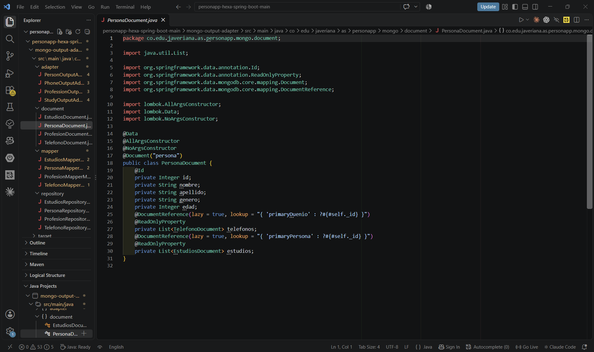

| Archivo / carpeta | Para qué sirve |
|---|---|
| `adapter/*OutputAdapterMongo.java` | Implementan los puertos de salida usando MongoDB. |
| `document/PersonaDocument`, `ProfesionDocument`, `TelefonoDocument`, `EstudiosDocument` | Clases mapeadas a colecciones de MongoDB con `@Document`. |
| `mapper/*MapperMongo.java` | Convierten entre documentos de Mongo y objetos de dominio. |
| `repository/*RepositoryMongo.java` | Interfaces que extienden `MongoRepository`. |

#### 2.8.16 Carpeta `scripts` y `tests`

Scripts para preparar las bases de datos. DDL significa definición de la estructura y DML, manipulación de datos.
**Captura 20.** Carpeta `scripts`, con `persona_ddl_maria.sql` abierto.

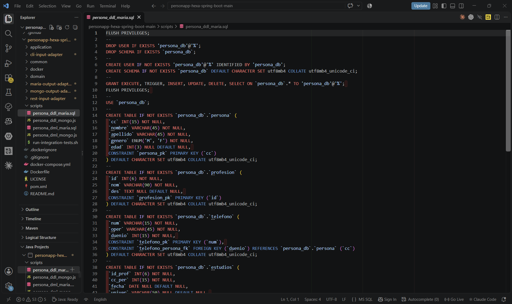

| Archivo | Para qué sirve |
|---|---|
| `scripts/persona_ddl_maria.sql` | Crea el usuario `persona_db`, el esquema y las tablas `persona`, `profesion`, `telefono` y `estudios` con sus llaves. |
| `scripts/persona_dml_maria.sql` | Inserta datos de ejemplo en MariaDB. |
| `scripts/persona_ddl_mongo.js` | Crea el usuario de la base `persona_db` en MongoDB. |
| `scripts/persona_dml_mongo.js` | Inserta datos de ejemplo en MongoDB. |
| `tests/run-integration-tests.sh` | Levanta los contenedores, espera a que la API responda y ejecuta las pruebas de integración. Está fuera de `scripts/` porque MariaDB ejecuta todos los `.sh` de esa carpeta al inicializarse. |

#### 2.8.17 `docker-compose.yml`

Orquesta todos los contenedores para levantar el sistema completo con un solo comando (`docker compose up -d --build`).
**Captura 21.** `docker-compose.yml`.

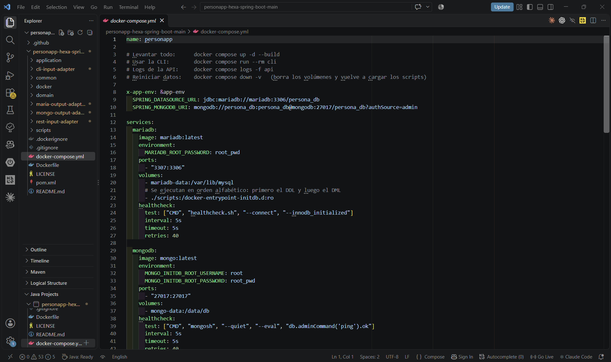

| Servicio | Para qué sirve |
|---|---|
| `mariadb` | Contenedor de MariaDB en el puerto 3307; carga automáticamente los scripts SQL. |
| `mongodb` | Contenedor de MongoDB en el puerto 27017. |
| `mongo-init` | Ejecuta `docker/mongo-init.sh` una vez para cargar los datos de MongoDB y termina. |
| `api` | Construye y ejecuta `rest-input-adapter` en el puerto 3000, cuando las bases ya están listas. |
| `cli` | Construye `cli-input-adapter`; se usa con `docker compose run --rm cli`. |

#### 2.8.18 Dockerfile

Construye la imagen de la aplicación en dos etapas (multi-stage build).
**Captura 22.** `Dockerfile`.

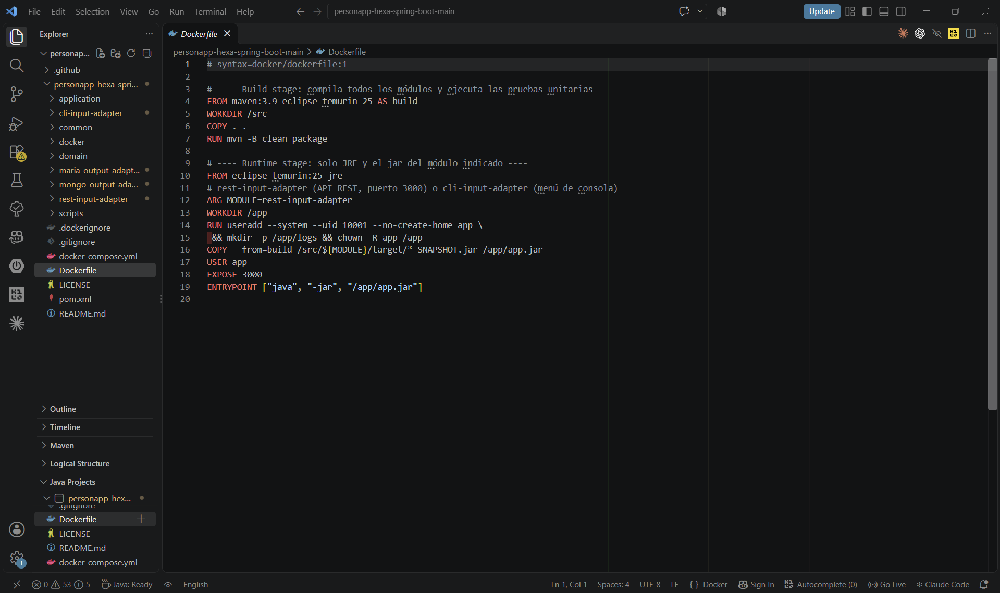

| Parte | Para qué sirve |
|---|---|
| Etapa `build` | Usa Maven con Java 25 para compilar todos los módulos y ejecutar las pruebas (`mvn clean package`). |
| Etapa de ejecución | Usa solo el JRE 25 y copia el `.jar` del módulo indicado en `ARG MODULE`. |
| `USER`, `EXPOSE`, `ENTRYPOINT` | Ejecuta con un usuario sin privilegios, expone el puerto 3000 y arranca con `java -jar`. |

#### 2.8.19 Conclusión del recorrido

El proyecto separa claramente las responsabilidades. El módulo `domain` y los casos de uso de `application` no conocen la API REST ni las bases de datos; solo se comunican mediante puertos. Gracias a esto existen dos adaptadores de entrada (REST y consola) y dos de salida (MariaDB y MongoDB) que usan la misma lógica de negocio, y se puede elegir la base de datos en cada petición mediante el `PersistenceRegistry`. Docker Compose permite levantar todo el sistema con un solo comando.

---

## 3. Procedimiento

Trabajamos en macOS con chip Apple Silicon. Se usó Docker Desktop para las bases de datos y para la ejecución del proyecto, de modo que el único requisito local es Docker. Para compilar sin Docker se usó Maven con JDK 25.

### 3.1 Ambiente

| Componente | Versión | Uso |
|---|---|---|
| macOS | arm64 (Apple Silicon) | Sistema de desarrollo |
| Docker Desktop / Compose | 29.2.0 / v5.0.2 | Contenedores |
| JDK | 25 (Temurin en la imagen; OpenJDK 25 en local) | Compilación y ejecución |
| Maven | 3.9+ | Construcción de los módulos |
| Spring Boot | 4.1.2 | Framework de la aplicación |
| Lombok | 1.18.48 | Reducción de código repetido |
| springdoc-openapi | 3.2.0 | Swagger UI y OpenAPI 3 |
| MariaDB Connector/J | 4.0.0 | Controlador JDBC |
| MariaDB | latest (probado con 13.0.2) | Base relacional |
| MongoDB | latest (probado con 9.0.4) | Base documental |

**Paso 1. Revisión de la plantilla.** Se hizo un fork del repositorio plantilla de la materia y se revisó su código. Con JDK 11 compilaba; con JDK 21 fallaba porque Lombok 1.18.26 no es compatible con ese compilador.

**Paso 2. Migración.** Se migró a JDK 25 y Spring Boot 4.1.2 porque se pidió usar las versiones más recientes. Esto implicó cambiar `javax.persistence` por `jakarta.persistence`, reemplazar `spring-boot-starter-web` por `spring-boot-starter-webmvc` y actualizar springdoc.

**Paso 3. Ejecución del original.** Para comparar, se ejecutó la plantilla sin cambios en una copia aparte. No arranca como jar ejecutable porque el `pom` no hereda el padre de Spring Boot, y su DML de MongoDB inserta en la base `prueba_db` en lugar de `persona_db`. Su endpoint POST responde 500 y no existen los endpoints de consulta por id, edición ni eliminación.

### 3.2 Bases de datos

**Paso 4. Levantar el stack.** `docker compose up -d --build` levanta MariaDB (puerto 3307), MongoDB (puerto 27017), el servicio `mongo-init`, la API (puerto 3000) y la CLI como perfil opcional.

**Paso 5. Carga de datos.** MariaDB ejecuta al crearse `persona_ddl_maria.sql` y `persona_dml_maria.sql`. MongoDB los ejecuta el servicio `mongo-init`, que crea el usuario y carga los datos después de que el servidor responde.

**Paso 6. Verificación.** Tras levantar el stack desde cero: 5 personas, 3 profesiones, 4 teléfonos y 4 estudios en cada base, y cero errores en el log de la API.

### 3.3 Implementación

**Paso 7. CRUD REST y CLI.** Se implementaron los puertos, los casos de uso, los adaptadores de salida para MariaDB y MongoDB, los controladores, los adaptadores de entrada, los mappers y los menús de consola para los cuatro módulos.

**Paso 8. Corrección de defectos.** Durante las pruebas se encontraron y corrigieron los siguientes defectos:

| Defecto | Causa | Solución |
|---|---|---|
| Listado de personas con 500 | Hibernate devolvía `java.sql.Date` y `toInstant()` no está soportado | Fecha de grado como `LocalDate` |
| Un POST con id existente sobrescribía el registro | `save()` hace merge | Verificación de existencia y respuesta 409 |
| Acentos corruptos (`Diseña`) | El esquema no definía `utf8mb4` | `utf8mb4` en esquema y tablas |
| MongoDB sin autenticación | Spring Boot 4 ignoraba las propiedades de usuario | URI con `authSource=admin` |
| Referencias lazy de MongoDB con id nulo | Las referencias perezosas no resolvían el id | Carga eager de las referencias |
| Teléfono o estudio con dueño inexistente producía 500 | Error de referencia no traducido | Validación y respuesta 409 |
| Género `X` daba 409 con mensaje engañoso | MariaDB solo admite `M` y `F` | Validación con respuesta 400 |
| Fecha mal formada producía 500 | `DateTimeParseException` no estaba en el manejador | Manejo en 400 |
| El runner de pruebas hacía fallar MariaDB | Un `.sh` dentro de `scripts/` se ejecuta al inicializar la base | Runner movido a `tests/` |

**Paso 9. Revisión de SOLID.** Se refactorizó el registro de motores, se segregó el puerto de entrada y se corrigió el contrato de Mongo. El detalle está en la sección 2.6.

### 3.4 Compilación y ejecución

**Paso 10. Compilación.** `mvn clean install` compila los siete módulos y ejecuta las pruebas unitarias.

**Paso 11. Ejecución con Docker.** `docker compose up -d --build` levanta el stack completo. La API responde en `http://localhost:3000/api-docs` y Swagger en `http://localhost:3000/swagger-ui.html`.

**Paso 12. Ejecución de la CLI.** `docker compose run --rm cli` abre el menú interactivo.

### 3.5 Pruebas

**Paso 13. Pruebas unitarias.** `mvn clean verify` ejecuta 67 pruebas, todas en verde:

| Módulo | Pruebas | Qué cubren |
|---|---|---|
| `common` | 10 | Registro de motores, `DatabaseOption` y validación `Entrada` |
| `application` | 17 | Casos de uso de persona, profesión, teléfono y estudio, con puertos simulados |
| `maria-output-adapter` | 5 | Mappers de MariaDB: ida y vuelta, lectura superficial y clave compuesta |
| `mongo-output-adapter` | 5 | Mappers de MongoDB: referencias por id y fechas |
| `rest-input-adapter` | 22 | Mappers REST y contratos HTTP de los controladores (200, 204, 400, 404, 409) |
| `cli-input-adapter` | 8 | Flujos de los menús con entrada simulada |

**Paso 14. Pruebas de integración.** `tests/run-integration-tests.sh` levanta el stack, espera a que la API responda y ejecuta 19 pruebas contra la API real, en MariaDB y en MongoDB. Cubren el CRUD completo de los cuatro módulos, los duplicados (409), las entradas inválidas (400), la base inválida (400), las referencias inexistentes (409) y las cascadas en ambas bases. Resultado: 19 de 19 en verde.

**Paso 15. Pruebas manuales.** Se probaron a mano casos límite con `curl` (DNI negativo, texto demasiado largo, fechas mal formadas, teléfono vacío y campos faltantes) y se corrigieron los defectos que aparecieron. Las peticiones de todos los endpoints están en `personapp.http`, y las 24 se verificaron contra la API con los códigos esperados.

**Paso 16. Pruebas de la CLI.** Se ejecutó la CLI en Docker con guiones de entrada completos en ambas bases: crear, buscar, editar, eliminar, duplicados, referencias inexistentes y opciones inválidas.

### 3.6 Control de versiones y entrega

**Paso 17. Commits.** Los cambios están en la rama `feature/crud-hexa-docker` del fork, con mensajes descriptivos y sin atribuciones automáticas. El Pull Request #1 compara la rama con `main`.

**Paso 18. Tag de entrega (pendiente).** La entrega se marcará con el tag anotado `v1.0.0` sobre la rama principal, con el mensaje "Entrega Laboratorio 2".

---

## 4. Conclusiones y lecciones aprendidas

1. **La arquitectura hexagonal permitió cambiar la entrada y la persistencia sin tocar el núcleo.** Agregar la CLI y el segundo motor de base de datos no obligó a modificar los casos de uso. Eso se verificó porque las pruebas unitarias del núcleo no cambiaron.
2. **Las versiones recientes tienen cambios que no están en la documentación de la versión anterior.** Spring Boot 4 movió propiedades de conexión, separó los starters y cambió el tipo de fecha que devuelve Hibernate. Migrar obligó a leer las notas de cada versión.
3. **Las referencias de MongoDB no son claves foráneas.** Hay que validar la existencia antes de guardar, y el borrado en cascada tiene que escribirse en el código. En MariaDB esto lo resuelve la base y el mapeo de JPA.
4. **Mapear relaciones en ambos sentidos genera ciclos.** Persona ↔ estudios se volvió recursivo en cuanto había datos. La solución fue mapear los objetos anidados de forma superficial.
5. **Las pruebas de borde encontraron defectos que las pruebas normales no veían.** Los seis defectos de entrada (DNI negativo, edad negativa, texto demasiado largo, género inválido, fecha mal formada y teléfono vacío) aparecieron solo al probar entradas inválidas. Por eso se agregaron pruebas de integración para esos casos.
6. **Un archivo en el lugar equivocado puede romper un contenedor.** El runner de pruebas dentro de `scripts/` hacía que MariaDB fallara al inicializarse, porque la imagen ejecuta todos los `.sh` de esa carpeta.
7. **La versión de Java importa.** Lombok 1.18.26 no compila con JDK 21. Con JDK 25 y Lombok 1.18.48 el proyecto compila sin cambios de código.
8. **Documentar las decisiones es parte del diseño.** Las decisiones de esta entrega (por ejemplo, 200 en lugar de 201 para los POST) quedaron registradas para poder revisarlas.

---

## 5. Referencias

Alistair Cockburn. (2005). *Hexagonal architecture*. https://alistair.cockburn.us/hexagonal-architecture/

Brown, S. (2018). *The C4 model for visualising software architecture*. https://c4model.com/

Fielding, R. T. (2000). *Architectural styles and the design of network-based software architectures* [Tesis doctoral, University of California, Irvine]. https://www.ics.uci.edu/~fielding/pubs/dissertation/top.htm

Fowler, M. (2002). *Patterns of Enterprise Application Architecture*. Addison-Wesley.

Martin, R. C. (2017). *Clean Architecture: A Craftsman's Guide to Software Structure and Design*. Prentice Hall.

OpenAPI Initiative. (2021). *OpenAPI Specification 3.0.3*. https://spec.openapis.org/oas/v3.0.3

Spring. *Spring Boot reference documentation* (versión 4.1). https://docs.spring.io/spring-boot/reference/

Spring. *Spring Data MongoDB reference documentation*. https://docs.spring.io/spring-data/mongodb/reference/

springdoc. *springdoc-openapi documentation*. https://springdoc.org/

MariaDB Foundation. *MariaDB Knowledge Base*. https://mariadb.com/kb/en/

MongoDB, Inc. *MongoDB Manual*. https://www.mongodb.com/docs/manual/

Docker Inc. *Docker Compose documentation*. https://docs.docker.com/compose/

PlantUML y C4-PlantUML. https://plantuml.com/ · https://github.com/plantuml-stdlib/C4-PlantUML

Project Lombok. *Lombok features*. https://projectlombok.org/features/
