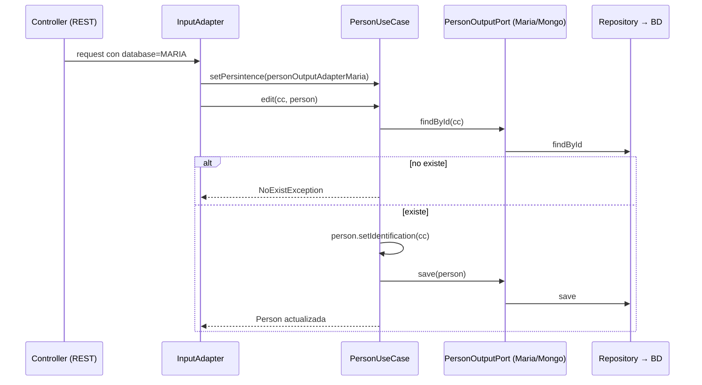

# Persona 1 — Núcleo (common, domain, application) y Maven

Rama: `persona1-nucleo`. Laboratorio 2 de Arquitectura de Software: PersonAPP en arquitectura
hexagonal con Repository y Service (JDK 11, Spring Boot 2.7, MariaDB, MongoDB, REST, CLI, Swagger 3).

Revisión detallada (tabla de problemas encontrados): [revision.md](revision.md).

## 1. Módulos del núcleo y por qué existen en hexagonal

En la arquitectura hexagonal (puertos y adaptadores) el **núcleo** contiene el negocio y no conoce
la tecnología: no sabe si los datos vienen de REST o de la terminal, ni si se guardan en MariaDB o
en MongoDB. Todo lo externo se conecta por **puertos** (interfaces) que implementan los **adaptadores**.
La dependencia siempre apunta hacia adentro: adaptadores → application → domain.

| Módulo | Qué contiene | Por qué existe |
|---|---|---|
| `common` | Anotaciones propias `@UseCase`, `@Adapter`, `@Mapper`, `@Port`; excepciones `NoExistException`, `InvalidOptionException`; enum `DatabaseOption` (MARIA, MONGO). | Aísla al resto del código de Spring: `@UseCase`/`@Adapter`/`@Mapper` son alias de `@Component`, así el núcleo no usa anotaciones del framework directamente. Las excepciones son compartidas por todas las capas. |
| `domain` | Modelo de negocio puro: `Person`, `Profession`, `Study`, `Phone`, `Gender`, con reglas propias (`Person.isValidAge()`). | Es el centro del hexágono. **No depende de Spring ni de ningún otro módulo** (solo Lombok en compilación). Así el negocio no cambia aunque cambie la base de datos o la interfaz. |
| `application` | **Puertos de entrada** (`port/in`, qué puede pedir el mundo exterior), **puertos de salida** (`port/out`, qué necesita el negocio de la persistencia) y **casos de uso** (`usecase`, implementan los puertos de entrada usando los de salida). | Es la capa de servicio: orquesta el dominio y aplica las reglas de aplicación (p. ej. "no se puede editar lo que no existe"). Depende solo de `domain` y `common`; las implementaciones concretas se inyectan. |

Correspondencia con los patrones pedidos:

- **Service** → los casos de uso (`PersonUseCase`, `ProfessionUseCase`, `StudyUseCase`, `PhoneUseCase`).
- **Repository** → los puertos de salida (`*OutputPort`) son la abstracción del repositorio; los
  adaptadores Maria/Mongo los implementan con Spring Data (`JpaRepository` / `MongoRepository`).

## 2. Contratos

Todos los puertos llevan `@Port` y los casos de uso `@UseCase` + `@Slf4j`. Cada caso de uso recibe
por constructor el adaptador Maria (`@Qualifier("<entidad>OutputAdapterMaria")`) y se puede cambiar
a Mongo con `setPersintence(...)` (el nombre conserva el typo original porque los adaptadores de
entrada ya lo usan).

### Puertos de entrada (`application/port/in`)

| Método | Person | Profession | Study | Phone |
|---|---|---|---|---|
| `setPersintence` | `(PersonOutputPort)` | `(ProfessionOutputPort)` | `(StudyOutputPort)` | `(PhoneOutputPort)` |
| `create` | `Person create(Person)` | `Profession create(Profession)` | `Study create(Study)` | `Phone create(Phone)` |
| `edit` * | `Person edit(Integer identification, Person)` | `Profession edit(Integer identification, Profession)` | `Study edit(Integer professionId, Integer personId, Study)` | `Phone edit(String number, Phone)` |
| `drop` * | `Boolean drop(Integer identification)` | `Boolean drop(Integer identification)` | `Boolean drop(Integer professionId, Integer personId)` | `Boolean drop(String number)` |
| `findAll` | `List<Person>` | `List<Profession>` | `List<Study>` | `List<Phone>` |
| `findOne` * | `Person findOne(Integer identification)` | `Profession findOne(Integer identification)` | `Study findOne(Integer professionId, Integer personId)` | `Phone findOne(String number)` |
| `count` | `Integer` | `Integer` | `Integer` | `Integer` |
| `getPhones` * | `List<Phone> getPhones(Integer identification)` | — | — | — |
| `getStudies` * | `List<Study> getStudies(Integer identification)` | — | — | — |

\* lanzan `NoExistException` si el registro no existe. `count()` = `findAll().size()`.

### Puertos de salida (`application/port/out`)

| Método | PersonOutputPort | ProfessionOutputPort | StudyOutputPort | PhoneOutputPort |
|---|---|---|---|---|
| `save` | `Person save(Person)` | `Profession save(Profession)` | `Study save(Study)` | `Phone save(Phone)` |
| `delete` | `Boolean delete(Integer identification)` | `Boolean delete(Integer identification)` | `Boolean delete(Integer professionId, Integer personId)` | `Boolean delete(String number)` |
| `find` | `List<Person> find()` | `List<Profession> find()` | `List<Study> find()` | `List<Phone> find()` |
| `findById` | `Person findById(Integer identification)` | `Profession findById(Integer identification)` | `Study findById(Integer professionId, Integer personId)` | `Phone findById(String number)` |

`findById` debe devolver `null` cuando no existe (el caso de uso convierte eso en `NoExistException`).
La llave de `Study` va siempre en el orden de la tabla `estudios`: `(id_prof, cc_per)`.

### Mensajes de `NoExistException`

Mismo formato que Persona: `"The <entidad> with id X does not exist into db, cannot be edited|dropped|found"`.
Teléfono usa `with number X`; Estudio usa `with profession id X and person id Y`.

## 3. Flujo de una petición (ejemplo Persona)

```mermaid
flowchart LR
    C[Cliente REST / Swagger<br/>o menú CLI] --> CTRL[PersonaControllerV1<br/>rest-input-adapter]
    CTRL --> IA[PersonaInputAdapterRest<br/>@Adapter]
    IA -- "setPersintence / new PersonUseCase(outputPort)" --> UC[PersonUseCase<br/>@UseCase · implementa PersonInputPort]
    UC -- "PersonOutputPort" --> OP{{Puerto de salida}}
    OP --> OAM[PersonOutputAdapterMaria<br/>@Adapter personOutputAdapterMaria]
    OP --> OAG[PersonOutputAdapterMongo<br/>@Adapter personOutputAdapterMongo]
    OAM --> RM[PersonaRepositoryMaria<br/>JpaRepository]
    OAG --> RG[PersonaRepositoryMongo<br/>MongoRepository]
    RM --> BM[(MariaDB<br/>tabla persona)]
    RG --> BG[(MongoDB<br/>colección persona)]
    UC -. usa .-> D[Person<br/>domain]
```

Secuencia de "editar persona" para la sustentación (el endpoint de edición en `/api/v1/persona`
lo agrega el compañero de REST; hoy el controller solo tiene GET y POST):



Los mappers de cada adaptador traducen entre el modelo de dominio y la entidad/documento de la BD
(`PersonaMapperMaria`, `PersonaMapperMongo`, `PersonaMapperRest`, `PersonaMapperCli`).

## 4. Instrucciones para mis compañeros

### Adaptadores de salida (MariaDB y MongoDB)

Crear estas clases anotadas con `@Adapter("<nombre exacto>")`, igual que `PersonOutputAdapterMaria`:

| Bean (nombre exacto) | Implementa | Métodos |
|---|---|---|
| `professionOutputAdapterMaria` | `ProfessionOutputPort` | `save`, `delete(Integer)`, `find`, `findById(Integer)` |
| `professionOutputAdapterMongo` | `ProfessionOutputPort` | idem |
| `studyOutputAdapterMaria` | `StudyOutputPort` | `save`, `delete(Integer professionId, Integer personId)`, `find`, `findById(Integer professionId, Integer personId)` |
| `studyOutputAdapterMongo` | `StudyOutputPort` | idem |
| `phoneOutputAdapterMaria` | `PhoneOutputPort` | `save`, `delete(String)`, `find`, `findById(String)` |
| `phoneOutputAdapterMongo` | `PhoneOutputPort` | idem |

- `findById` → `null` si no existe (no lanzar excepción ahí).
- `delete` → `true`/`false` según si quedó borrado.
- En Maria, la PK de `estudios` es compuesta: construir el `EstudiosEntityPK(idProf, ccPer)` en ese orden.
- `Gender` sigue siendo `MALE, FEMALE, OTHER` (no se cambió). La columna es `ENUM('M','F')`: desde la
  rama `fix-plantilla` los mappers de Persona (Maria y Mongo) lanzan `IllegalArgumentException` si el
  género es `OTHER` o `null` (ver [docs/fix-plantilla.md](../fix-plantilla.md)).
- En `EstudiosMapper` y `TelefonoMapper` usar `fromDomainToAdapterShallow` / `fromAdapterToDomainShallow`
  de `PersonaMapper` y `ProfesionMapper` para la persona o profesión relacionada (evita recursión).
- `Person.isValidAge()` ahora acepta `age == null` (edad opcional).

> **Importante:** las apps escanean `co.edu.javeriana.as.personapp`, así que `ProfessionUseCase`,
> `StudyUseCase` y `PhoneUseCase` ya son beans. **Mientras no existan al menos los tres beans
> `*OutputAdapterMaria`, `PersonAppRestApi` y `PersonAppCli` no arrancan** (Spring reporta
> *"Parameter 0 of constructor in ...UseCase required a bean ... that could not be found"*).
> La compilación (`mvn clean install`) no se ve afectada.

### Adaptadores de entrada (REST y CLI)

Igual que `PersonaInputAdapterRest`/`PersonaInputAdapterCli`: inyectar los dos output ports con
`@Qualifier` (Maria y Mongo) y elegir con `new XUseCase(outputPort)` o `setPersintence(outputPort)`
según `DatabaseOption`. Capturar `NoExistException` para responder 404 / mensaje en el menú.

### Cómo compilar

```bash
mvn clean install            # desde la raíz: compila todo y corre las 34 pruebas
mvn -pl rest-input-adapter spring-boot:run   # requiere haber hecho install antes
```

Con JDK 17 instalado el código se compila con `--release 11`, así que solo se pueden usar APIs de Java 11.

## 5. Cambios realizados (antes → después)

| # | Archivo | Antes | Después |
|---|---|---|---|
| 1 | `PersonUseCase.edit` | Guardaba `person` tal cual llegaba (si traía otra cédula, editaba/creaba otro registro). | `person.setIdentification(identification)` antes de `save`. |
| 2 | `Person.isValidAge` | `this.age >= 0` → NPE si `age == null`. | `this.age == null \|\| this.age >= 0`. |
| 3 | `Person`, `Profession` | `equals/hashCode` de `@Data` recorrían las listas → recursión infinita con relaciones bidireccionales. | `@EqualsAndHashCode.Exclude` en `phoneNumbers` y `studies` (como ya estaba `@ToString.Exclude`). |
| 4 | `Phone` | Sin `@RequiredArgsConstructor`. | **Sin cambios**: se intentó, pero choca con `@AllArgsConstructor` (los 3 campos son `@NonNull`, misma firma) y no compila. Se revirtió; el constructor completo ya valida los `@NonNull`. |
| 5 | `pom.xml` raíz | `maven.compiler.source/target=11`; Boot 2.7.11; Spring 5.3.27. | `maven.compiler.release=11`; Boot 2.7.18; Spring 5.3.31. |
| 6 | `pom.xml` raíz | `${revision}` quedaba literal en los poms instalados; fallaba compilar un módulo suelto. | `flatten-maven-plugin` 1.5.0 (`resolveCiFriendliesOnly`, salida en `target/`). |
| 7 | `application` | Solo Persona. | Puertos in/out y casos de uso de Profesión, Estudio y Teléfono. |
| 8 | `application/pom.xml` | Sin pruebas. | `spring-boot-starter-test` y `spring-aop` (scope `test`) + 34 pruebas JUnit 5/Mockito. |
| 9 | `pom.xml` raíz | Lombok 1.18.26 (no compila con JDK 21). | Lombok 1.18.36, compatible con JDK 11, 17 y 21. |

## 6. Decisiones tomadas

- **Study.edit conserva la llave**: en vez de modificar los objetos `Person`/`Profession` que llegan,
  el caso de uso reemplaza `study.person` y `study.profession` por los del registro existente
  (equivalente a asignar `identification` en Persona). Solo cambian `graduationDate` y `universityName`.
- **Phone.edit / Profession.edit** asignan el id recibido (`setNumber`, `setIdentification`), igual que Persona.
- **No se tocó `Gender`** ni los módulos de los compañeros; los hallazgos de su lado quedan arriba.
- **`spring-aop` solo en test**: la exclusión en `common` se mantiene para no cambiar el classpath de
  producción.
- **`log4j-to-slf4j` heredado por `domain`** se deja: moverlo del pom raíz afecta a todos los módulos.
- **Flatten en `target/`**: `.gitignore` no es de mi parte, así que el pom aplanado se genera dentro
  de `target/` (ya ignorado).
- No se crearon adaptadores. Con `docker compose up -d` se confirmó que las apps solo fallan al arrancar
  por los beans de Profesión/Estudio/Teléfono que faltan (pendiente de Persona 2).

## 7. Verificación

- `mvn clean install` desde la raíz con JDK 17.0.20 (`--release 11`): **BUILD SUCCESS** en los 8 módulos,
  **34 pruebas, 0 fallos, 0 errores**.
- `grep` en `domain`: ningún import de `org.springframework`; `dependency:tree` de `domain` solo muestra
  `lombok` (provided) y `log4j-to-slf4j`.
