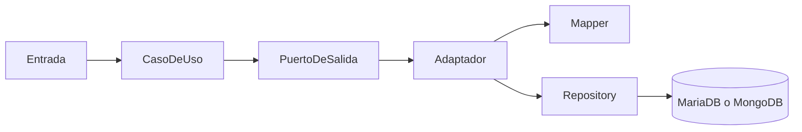

# Guía de sustentación de Persona 2

## Recorrido de una operación CRUD

La entrada selecciona una implementación del puerto. El caso de uso llama a save, find, findById o delete. El adaptador convierte entre el dominio y la representación de persistencia usando el mapper y delega al repositorio. Spring Data crea un proxy del repositorio; JPA usa EntityManager/Hibernate y el driver MariaDB, mientras MongoRepository usa MongoTemplate y el driver MongoDB. El motor ejecuta las consultas. El dominio permanece sin anotaciones de persistencia.



No hay sincronización entre los dos motores. Cada petición utiliza una implementación del puerto.

## Cada adaptador y sus métodos

Todos implementan el puerto correspondiente. save inserta o actualiza según el ID y devuelve el objeto convertido. find transforma la lista completa. findById convierte un Optional o devuelve null. delete borra por ID y comprueba ausencia. JPA puede lanzar EmptyResultDataAccessException al borrar un ID inexistente; MongoDB admite esa operación.

| Adaptador y función | Métodos exactos |
|---|---|
| PersonOutputAdapterMaria: personas | [save](../../maria-output-adapter/src/main/java/co/edu/javeriana/as/personapp/mariadb/adapter/PersonOutputAdapterMaria.java#L31) (línea 31); [find](../../maria-output-adapter/src/main/java/co/edu/javeriana/as/personapp/mariadb/adapter/PersonOutputAdapterMaria.java#L45) (línea 45); [findById](../../maria-output-adapter/src/main/java/co/edu/javeriana/as/personapp/mariadb/adapter/PersonOutputAdapterMaria.java#L52) (línea 52); [delete](../../maria-output-adapter/src/main/java/co/edu/javeriana/as/personapp/mariadb/adapter/PersonOutputAdapterMaria.java#L38) (línea 38) |
| ProfessionOutputAdapterMaria: profesiones | [save](../../maria-output-adapter/src/main/java/co/edu/javeriana/as/personapp/mariadb/adapter/ProfessionOutputAdapterMaria.java#L25) (línea 25); [find](../../maria-output-adapter/src/main/java/co/edu/javeriana/as/personapp/mariadb/adapter/ProfessionOutputAdapterMaria.java#L38) (línea 38); [findById](../../maria-output-adapter/src/main/java/co/edu/javeriana/as/personapp/mariadb/adapter/ProfessionOutputAdapterMaria.java#L45) (línea 45); [delete](../../maria-output-adapter/src/main/java/co/edu/javeriana/as/personapp/mariadb/adapter/ProfessionOutputAdapterMaria.java#L32) (línea 32) |
| StudyOutputAdapterMaria: relación persona-profesión | [save](../../maria-output-adapter/src/main/java/co/edu/javeriana/as/personapp/mariadb/adapter/StudyOutputAdapterMaria.java#L29) (línea 29); [find](../../maria-output-adapter/src/main/java/co/edu/javeriana/as/personapp/mariadb/adapter/StudyOutputAdapterMaria.java#L45) (línea 45); [findById](../../maria-output-adapter/src/main/java/co/edu/javeriana/as/personapp/mariadb/adapter/StudyOutputAdapterMaria.java#L50) (línea 50); [delete](../../maria-output-adapter/src/main/java/co/edu/javeriana/as/personapp/mariadb/adapter/StudyOutputAdapterMaria.java#L39) (línea 39) |
| PhoneOutputAdapterMaria: teléfonos y dueño | [save](../../maria-output-adapter/src/main/java/co/edu/javeriana/as/personapp/mariadb/adapter/PhoneOutputAdapterMaria.java#L25) (línea 25); [find](../../maria-output-adapter/src/main/java/co/edu/javeriana/as/personapp/mariadb/adapter/PhoneOutputAdapterMaria.java#L39) (línea 39); [findById](../../maria-output-adapter/src/main/java/co/edu/javeriana/as/personapp/mariadb/adapter/PhoneOutputAdapterMaria.java#L44) (línea 44); [delete](../../maria-output-adapter/src/main/java/co/edu/javeriana/as/personapp/mariadb/adapter/PhoneOutputAdapterMaria.java#L33) (línea 33) |
| PersonOutputAdapterMongo: personas | [save](../../mongo-output-adapter/src/main/java/co/edu/javeriana/as/personapp/mongo/adapter/PersonOutputAdapterMongo.java#L29) (línea 29); [find](../../mongo-output-adapter/src/main/java/co/edu/javeriana/as/personapp/mongo/adapter/PersonOutputAdapterMongo.java#L56) (línea 56); [findById](../../mongo-output-adapter/src/main/java/co/edu/javeriana/as/personapp/mongo/adapter/PersonOutputAdapterMongo.java#L63) (línea 63); [delete](../../mongo-output-adapter/src/main/java/co/edu/javeriana/as/personapp/mongo/adapter/PersonOutputAdapterMongo.java#L46) (línea 46) |
| ProfessionOutputAdapterMongo: profesiones | [save](../../mongo-output-adapter/src/main/java/co/edu/javeriana/as/personapp/mongo/adapter/ProfessionOutputAdapterMongo.java#L24) (línea 24); [find](../../mongo-output-adapter/src/main/java/co/edu/javeriana/as/personapp/mongo/adapter/ProfessionOutputAdapterMongo.java#L38) (línea 38); [findById](../../mongo-output-adapter/src/main/java/co/edu/javeriana/as/personapp/mongo/adapter/ProfessionOutputAdapterMongo.java#L43) (línea 43); [delete](../../mongo-output-adapter/src/main/java/co/edu/javeriana/as/personapp/mongo/adapter/ProfessionOutputAdapterMongo.java#L29) (línea 29) |
| StudyOutputAdapterMongo: relación persona-profesión | [save](../../mongo-output-adapter/src/main/java/co/edu/javeriana/as/personapp/mongo/adapter/StudyOutputAdapterMongo.java#L27) (línea 27); [find](../../mongo-output-adapter/src/main/java/co/edu/javeriana/as/personapp/mongo/adapter/StudyOutputAdapterMongo.java#L41) (línea 41); [findById](../../mongo-output-adapter/src/main/java/co/edu/javeriana/as/personapp/mongo/adapter/StudyOutputAdapterMongo.java#L46) (línea 46); [delete](../../mongo-output-adapter/src/main/java/co/edu/javeriana/as/personapp/mongo/adapter/StudyOutputAdapterMongo.java#L35) (línea 35) |
| PhoneOutputAdapterMongo: teléfonos y dueño | [save](../../mongo-output-adapter/src/main/java/co/edu/javeriana/as/personapp/mongo/adapter/PhoneOutputAdapterMongo.java#L24) (línea 24); [find](../../mongo-output-adapter/src/main/java/co/edu/javeriana/as/personapp/mongo/adapter/PhoneOutputAdapterMongo.java#L38) (línea 38); [findById](../../mongo-output-adapter/src/main/java/co/edu/javeriana/as/personapp/mongo/adapter/PhoneOutputAdapterMongo.java#L43) (línea 43); [delete](../../mongo-output-adapter/src/main/java/co/edu/javeriana/as/personapp/mongo/adapter/PhoneOutputAdapterMongo.java#L32) (línea 32) |

StudyOutputAdapterMaria.save carga los dos padres existentes; PhoneOutputAdapterMaria.save carga el dueño. Se rechazan referencias inexistentes y no se crean ni actualizan padres al guardar hijos. Las transacciones cubren también el mapeo de las relaciones. ProfessionOutputAdapterMaria tiene frontera transaccional para acceder a su lista LAZY; open-in-view está desactivado.

StudyOutputAdapterMongo.save y PhoneOutputAdapterMongo.save comprueban que los padres existan. ProfessionOutputAdapterMongo.delete y PersonOutputAdapterMongo.delete rechazan padres con hijos. Son comprobaciones secuenciales; MongoDB standalone no ofrece aquí una transacción entre colecciones ni una FK frente a clientes externos o escrituras concurrentes.

## Cada repositorio

JpaRepository<T, ID> hereda operaciones de guardado, consulta, borrado, paginación y flush. Spring genera la implementación, no una clase escrita por nosotros. Hibernate puede aplazar un INSERT o DELETE hasta flush/commit; una FK puede fallar al terminar la transacción aunque el método interno save ya haya retornado.

MongoRepository<T, ID> ofrece operaciones sobre documentos identificados por _id. Guardar un documento no produce una cascada de guardado de sus referencias. Las listas inversas ReadOnlyProperty se consultan desde los hijos y no se escriben como hijos embebidos.

| Declaración exacta | Modelo e ID | Métodos |
|---|---|---|
| [PersonaRepositoryMaria.java](../../maria-output-adapter/src/main/java/co/edu/javeriana/as/personapp/mariadb/repository/PersonaRepositoryMaria.java#L8) (línea 8) | PersonaEntity, Integer | save, findAll, findById, existsById y deleteById heredados |
| [ProfesionRepositoryMaria.java](../../maria-output-adapter/src/main/java/co/edu/javeriana/as/personapp/mariadb/repository/ProfesionRepositoryMaria.java#L6) (línea 6) | ProfesionEntity, Integer | save, findAll, findById, existsById y deleteById heredados |
| [EstudiosRepositoryMaria.java](../../maria-output-adapter/src/main/java/co/edu/javeriana/as/personapp/mariadb/repository/EstudiosRepositoryMaria.java#L7) (línea 7) | EstudiosEntity, EstudiosEntityPK | save, findAll, findById, existsById y deleteById heredados |
| [TelefonoRepositoryMaria.java](../../maria-output-adapter/src/main/java/co/edu/javeriana/as/personapp/mariadb/repository/TelefonoRepositoryMaria.java#L6) (línea 6) | TelefonoEntity, String | save, findAll, findById, existsById y deleteById heredados |
| [PersonaRepositoryMongo.java](../../mongo-output-adapter/src/main/java/co/edu/javeriana/as/personapp/mongo/repository/PersonaRepositoryMongo.java#L7) (línea 7) | PersonaDocument, Integer | save, findAll, findById, existsById y deleteById heredados |
| [ProfesionRepositoryMongo.java](../../mongo-output-adapter/src/main/java/co/edu/javeriana/as/personapp/mongo/repository/ProfesionRepositoryMongo.java#L6) (línea 6) | ProfesionDocument, Integer | save, findAll, findById, existsById y deleteById heredados |
| [EstudiosRepositoryMongo.java](../../mongo-output-adapter/src/main/java/co/edu/javeriana/as/personapp/mongo/repository/EstudiosRepositoryMongo.java#L6) (línea 6) | EstudiosDocument, String | save, findAll, findById, existsById y deleteById heredados |
| [TelefonoRepositoryMongo.java](../../mongo-output-adapter/src/main/java/co/edu/javeriana/as/personapp/mongo/repository/TelefonoRepositoryMongo.java#L6) (línea 6) | TelefonoDocument, String | save, findAll, findById, existsById y deleteById heredados |

Las consultas explícitas que protegen las referencias Mongo están en [existsByProfessionId / existsByPersonId](../../mongo-output-adapter/src/main/java/co/edu/javeriana/as/personapp/mongo/repository/EstudiosRepositoryMongo.java#L8) (línea 8) y [existsByOwnerId](../../mongo-output-adapter/src/main/java/co/edu/javeriana/as/personapp/mongo/repository/TelefonoRepositoryMongo.java#L8) (línea 8). Consultan los identificadores almacenados en primaryProfesion, primaryPersona y primaryDuenio.

## Cada mapper

| Mapper | Atributos y métodos exactos |
|---|---|
| PersonaMapperMaria | ID, nombre, apellido, género, edad; la conversión completa incluye estudios y teléfonos. [fromDomainToAdapter](../../maria-output-adapter/src/main/java/co/edu/javeriana/as/personapp/mariadb/mapper/PersonaMapperMaria.java#L28) (línea 28); [fromAdapterToDomain](../../maria-output-adapter/src/main/java/co/edu/javeriana/as/personapp/mariadb/mapper/PersonaMapperMaria.java#L70) (línea 70); [fromDomainToAdapterShallow](../../maria-output-adapter/src/main/java/co/edu/javeriana/as/personapp/mariadb/mapper/PersonaMapperMaria.java#L29) (línea 29); [fromAdapterToDomainShallow](../../maria-output-adapter/src/main/java/co/edu/javeriana/as/personapp/mariadb/mapper/PersonaMapperMaria.java#L71) (línea 71) |
| ProfesionMapperMaria | ID, nombre, descripción; la conversión completa incluye estudios. [fromDomainToAdapter](../../maria-output-adapter/src/main/java/co/edu/javeriana/as/personapp/mariadb/mapper/ProfesionMapperMaria.java#L21) (línea 21); [fromAdapterToDomain](../../maria-output-adapter/src/main/java/co/edu/javeriana/as/personapp/mariadb/mapper/ProfesionMapperMaria.java#L45) (línea 45); [fromDomainToAdapterShallow](../../maria-output-adapter/src/main/java/co/edu/javeriana/as/personapp/mariadb/mapper/ProfesionMapperMaria.java#L22) (línea 22); [fromAdapterToDomainShallow](../../maria-output-adapter/src/main/java/co/edu/javeriana/as/personapp/mariadb/mapper/ProfesionMapperMaria.java#L46) (línea 46) |
| EstudiosMapperMaria | persona, profesión, fecha, universidad; PK(idProf, ccPer) en Maria e ID persona-profesión en Mongo. [fromDomainToAdapter](../../maria-output-adapter/src/main/java/co/edu/javeriana/as/personapp/mariadb/mapper/EstudiosMapperMaria.java#L23) (línea 23); [fromAdapterToDomain](../../maria-output-adapter/src/main/java/co/edu/javeriana/as/personapp/mariadb/mapper/EstudiosMapperMaria.java#L46) (línea 46) |
| TelefonoMapperMaria | número, compañía y dueño superficial. [fromDomainToAdapter](../../maria-output-adapter/src/main/java/co/edu/javeriana/as/personapp/mariadb/mapper/TelefonoMapperMaria.java#L18) (línea 18); [fromAdapterToDomain](../../maria-output-adapter/src/main/java/co/edu/javeriana/as/personapp/mariadb/mapper/TelefonoMapperMaria.java#L30) (línea 30) |
| PersonaMapperMongo | ID, nombre, apellido, género, edad; la conversión completa incluye estudios y teléfonos. [fromDomainToAdapter](../../mongo-output-adapter/src/main/java/co/edu/javeriana/as/personapp/mongo/mapper/PersonaMapperMongo.java#L28) (línea 28); [fromAdapterToDomain](../../mongo-output-adapter/src/main/java/co/edu/javeriana/as/personapp/mongo/mapper/PersonaMapperMongo.java#L70) (línea 70); [fromDomainToAdapterShallow](../../mongo-output-adapter/src/main/java/co/edu/javeriana/as/personapp/mongo/mapper/PersonaMapperMongo.java#L29) (línea 29); [fromAdapterToDomainShallow](../../mongo-output-adapter/src/main/java/co/edu/javeriana/as/personapp/mongo/mapper/PersonaMapperMongo.java#L71) (línea 71) |
| ProfesionMapperMongo | ID, nombre, descripción; la conversión completa incluye estudios. [fromDomainToAdapter](../../mongo-output-adapter/src/main/java/co/edu/javeriana/as/personapp/mongo/mapper/ProfesionMapperMongo.java#L21) (línea 21); [fromAdapterToDomain](../../mongo-output-adapter/src/main/java/co/edu/javeriana/as/personapp/mongo/mapper/ProfesionMapperMongo.java#L45) (línea 45); [fromDomainToAdapterShallow](../../mongo-output-adapter/src/main/java/co/edu/javeriana/as/personapp/mongo/mapper/ProfesionMapperMongo.java#L22) (línea 22); [fromAdapterToDomainShallow](../../mongo-output-adapter/src/main/java/co/edu/javeriana/as/personapp/mongo/mapper/ProfesionMapperMongo.java#L46) (línea 46) |
| EstudiosMapperMongo | persona, profesión, fecha, universidad; PK(idProf, ccPer) en Maria e ID persona-profesión en Mongo. [fromDomainToAdapter](../../mongo-output-adapter/src/main/java/co/edu/javeriana/as/personapp/mongo/mapper/EstudiosMapperMongo.java#L25) (línea 25); [fromAdapterToDomain](../../mongo-output-adapter/src/main/java/co/edu/javeriana/as/personapp/mongo/mapper/EstudiosMapperMongo.java#L55) (línea 55) |
| TelefonoMapperMongo | número, compañía y dueño superficial. [fromDomainToAdapter](../../mongo-output-adapter/src/main/java/co/edu/javeriana/as/personapp/mongo/mapper/TelefonoMapperMongo.java#L18) (línea 18); [fromAdapterToDomain](../../mongo-output-adapter/src/main/java/co/edu/javeriana/as/personapp/mongo/mapper/TelefonoMapperMongo.java#L30) (línea 30) |

La recursión se produciría si Persona convierte Estudios y cada Estudio vuelve a convertir Persona completa. Shallow conserva los atributos del padre sin recorrer sus colecciones: interrumpe el ciclo y mantiene sus identificadores. Se conservan los métodos y pruebas de Samuel.

Los textos opcionales siguen la convención de cadena vacía y las fechas nulas se conservan. Al guardar, género debe ser M/F; OTHER se rechaza. Los mappers superficiales de lectura toleran una relación sin resolver. EstudiosMaria recupera sus IDs desde la PK si falta el objeto relacionado.

La conversión de fecha SQL se encuentra en [validateGraduationDate](../../maria-output-adapter/src/main/java/co/edu/javeriana/as/personapp/mariadb/mapper/EstudiosMapperMaria.java#L61) (línea 61): java.sql.Date.toLocalDate() permite leer DATE, mientras java.sql.Date.toInstant() no está soportado.

## Llaves y relaciones

- [EstudiosEntityPK(int idProf, int ccPer)](../../maria-output-adapter/src/main/java/co/edu/javeriana/as/personapp/mariadb/entity/EstudiosEntityPK.java#L29) (línea 29): Contiene ambos componentes; equals y hashCode comparan los dos.
- [EstudiosEntity](../../maria-output-adapter/src/main/java/co/edu/javeriana/as/personapp/mariadb/entity/EstudiosEntity.java#L31) (línea 31): EmbeddedId escribe las columnas. Los ManyToOne comparten esas columnas y son insertable=false/updatable=false: sirven para navegar a los padres.
- [TelefonoEntity.duenio](../../maria-output-adapter/src/main/java/co/edu/javeriana/as/personapp/mariadb/entity/TelefonoEntity.java#L33) (línea 33): Es la FK al dueño, sin cascada hacia el padre.
- [DDL: PK y FK](../../scripts/persona_ddl_maria.sql#L43) (línea 43): Define las restricciones reales del motor.
- [PersonaEntity](../../maria-output-adapter/src/main/java/co/edu/javeriana/as/personapp/mariadb/entity/PersonaEntity.java#L45) (línea 45): Conserva PERSIST/MERGE y excluye REMOVE: borrar padres no borra accidentalmente hijos; la FK rechaza padres referenciados.
- [ProfesionEntity](../../maria-output-adapter/src/main/java/co/edu/javeriana/as/personapp/mariadb/entity/ProfesionEntity.java#L38) (línea 38): Conserva PERSIST/MERGE y excluye REMOVE: borrar padres no borra accidentalmente hijos; la FK rechaza padres referenciados.
- [EstudiosDocument](../../mongo-output-adapter/src/main/java/co/edu/javeriana/as/personapp/mongo/document/EstudiosDocument.java#L21) (línea 21): Conserva las referencias originales. MongoDB no impone FK; se crean primero padres y después hijos mediante sus respectivos adaptadores.
- [TelefonoDocument](../../mongo-output-adapter/src/main/java/co/edu/javeriana/as/personapp/mongo/document/TelefonoDocument.java#L20) (línea 20): Conserva las referencias originales. MongoDB no impone FK; se crean primero padres y después hijos mediante sus respectivos adaptadores.
- [PersonaDocument](../../mongo-output-adapter/src/main/java/co/edu/javeriana/as/personapp/mongo/document/PersonaDocument.java#L26) (línea 26): Conserva las referencias originales. MongoDB no impone FK; se crean primero padres y después hijos mediante sus respectivos adaptadores.
- [ProfesionDocument](../../mongo-output-adapter/src/main/java/co/edu/javeriana/as/personapp/mongo/document/ProfesionDocument.java#L24) (línea 24): Conserva las referencias originales. MongoDB no impone FK; se crean primero padres y después hijos mediante sus respectivos adaptadores.

## Selección de persistencia

[PersonaInputAdapterRest.setPersonOutputPortInjection](../../rest-input-adapter/src/main/java/co/edu/javeriana/as/personapp/adapter/PersonaInputAdapterRest.java#L40) (línea 40) crea PersonUseCase con el bean Maria o Mongo según la opción recibida. [ProfessionUseCase constructor](../../application/src/main/java/co/edu/javeriana/as/personapp/application/usecase/ProfessionUseCase.java#L20) (línea 20) y los constructores equivalentes de StudyUseCase y PhoneUseCase inyectan Maria por defecto. Los adaptadores Mongo están listos para que Persona 3 los conecte; esa selección no fue modificada.

## Docker Compose

Compose declara servicios, red, volúmenes y condiciones de arranque. Su red predeterminada proporciona DNS por nombre de servicio: desde REST, mariadb:3306 y mongodb:27017 apuntan a las bases; localhost apuntaría a REST mismo. Desde el host se usan MariaDB:3307 y MongoDB:27017.

- [REST: construcción con Maven/JDK 21](../../Dockerfile.rest#L1) (línea 1).
- [CLI: ejecución con JRE 11](../../Dockerfile.cli#L7) (línea 7).
- [servicio rest](../../docker-compose.yml#L45) (línea 45).
- [variables Spring compartidas](../../docker-compose.yml#L51) (línea 51).
- [dependencias healthy](../../docker-compose.yml#L61) (línea 61).
- [CLI con stdin abierto y TTY](../../docker-compose.yml#L73) (línea 73).
- [Volúmenes persistentes](../../docker-compose.yml#L83) (línea 83).

Las imágenes compilan el reactor con destino Java 11. Ejecutan package y spring-boot:repackage juntos para crear el jar ejecutable sin cambiar los POM de entrada. Los scripts de docker-entrypoint-initdb.d se ejecutan solo en volúmenes vacíos. Recrear la aplicación no borra datos ni vuelve a ejecutar los scripts. Las variables de credenciales de las apps deben coincidir con los usuarios ya creados en las bases.

```bash
docker compose up -d --build rest
docker compose build cli
docker compose run --rm cli
docker compose ps
```

## Evidencia de pruebas

- [CRUD real mariadb](../../maria-output-adapter/src/test/java/co/edu/javeriana/as/personapp/mariadb/adapter/PersistenceIntegrationTest.java#L43) (línea 43): CRUD, inexistentes, dos estudios para una persona, relaciones inversas y borrado protegido. MariaDB verifica también PK y FK con SQL directo.
- [CRUD real mongo](../../mongo-output-adapter/src/test/java/co/edu/javeriana/as/personapp/mongo/adapter/PersistenceIntegrationTest.java#L39) (línea 39): CRUD, inexistentes, dos estudios para una persona, relaciones inversas y borrado protegido. MariaDB verifica también PK y FK con SQL directo.
- [sqlDateAndMissingRelationsRetainCompositeIdentifiers](../../maria-output-adapter/src/test/java/co/edu/javeriana/as/personapp/mariadb/mapper/EstudiosMapperMariaTest.java#L63) (línea 63).
- [domainMappingSetsBothParentsWithoutRecursion](../../maria-output-adapter/src/test/java/co/edu/javeriana/as/personapp/mariadb/mapper/EstudiosMapperMariaTest.java#L73) (línea 73).

Los tests de los adaptadores nuevos prueban delegación y conversión con Mockito. Las integraciones usan los dos motores reales al habilitar -Dpersistence.integration=true. Cada una limpia únicamente sus registros propios. Los resultados ejecutados y sus límites se detallan en RESULTADOS.md; construir una imagen no demuestra por sí solo arranque o CRUD.

## Preguntas para practicar

1. ¿Por qué el puerto recibe professionId, personId, pero Mongo construye persona-profesión?
2. ¿Por qué se asignan la PK de Estudios y también sus objetos padre?
3. ¿Cuándo ejecuta Hibernate el SQL y cuándo se valida una FK?
4. ¿Qué diferencia hay entre PERSIST, MERGE y REMOVE?
5. ¿Por qué guardar PersonaDocument no guarda sus listas ReadOnlyProperty?
6. ¿Qué datos conserva Shallow y qué recorrido corta?
7. ¿Por qué se usan nombres de servicios en vez de localhost entre contenedores?
8. ¿Qué datos permanecen al recrear un contenedor?
9. ¿Qué demuestra una prueba real que no demuestra Mockito?
10. ¿Qué limitación tienen las comprobaciones MongoDB bajo concurrencia?
